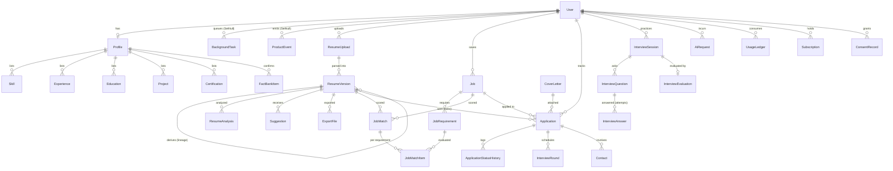

# 04 — Architecture

> Part of the [PRD index](../PRD.md). If this file contradicts the index, **the index wins**.
> Labels: **[D]** founder decision · **[P]** proposed by Claude (changeable) · **[?]** open / verify at setup
> Inputs: PRD §3, §5, §5b and §7 (decisions, glossary, constants, MVP security baseline), [research/05](../research/05-ats-mechanics-and-tech.md) Part B, [research/04](../research/04-legal-privacy-security.md) §5, founder SRD §18–23 and §30.
> **Platform rule [D] (founder, 2026-10-21): only 5 platforms: GitHub · Vercel · Supabase · Anthropic · Resend.** Anything else (queue, error tracking, analytics, rate limiting, backups) is built in-house on Supabase Postgres or GitHub Actions.
> Free-tier figures were re-checked on vendor pages on **2026-10-21** unless marked **(unverified)** or "prior knowledge". Re-check them at signup; they change often.

---

## 1. Architecture overview

### 1.1 Shape of the system [P]
- **One deployable Next.js app** (App Router, TypeScript) on Vercel. It serves the marketing pages (SSR/SSG for SEO), the authenticated app (PWA), the JSON API (route handlers), form mutations (server actions), and two **internal task endpoints**: `/api/tasks/run` (the worker) and `/api/tasks/tick` (the clock, called by pg_cron).
- **One Supabase project per environment** (Singapore, `ap-southeast-1`) provides four things: **Postgres** (accessed only by the server through Prisma), **Auth** (email/password + Google, cookie sessions via `@supabase/ssr`), **Storage** (private buckets, signed URLs) and **pg_cron + pg_net** (a once-a-minute HTTP call into our tick endpoint). We do **not** use the Supabase Data API from the browser, Realtime or Edge Functions in MVP.
- **Backend layering is kept explicit**, even though it sits in the same repo as the UI: `transport (route handler / server action / task handler) → service → repository → Prisma`. Transport code holds no business logic. This keeps the backend as readable and testable as the Express service the SRD described, and it can be pulled out later (§14, ADR-01).
- **Deterministic first** [D]: parsing, ATS checks, normalization and every score run in plain TypeScript. The LLM is only called through `AiProvider` (§6) for language tasks.
- **Async by default for heavy work**: parsing, analysis, matching, tailoring, export and interview evaluation run as rows in our own **`BackgroundTask` queue** (§7), processed by the worker endpoint one task per invocation. The UI polls a task status endpoint. The **only synchronous LLM path** is the mock-interview turn, which streams.
- **In-house platform tables** replace third-party services: `BackgroundTask` (queue), `ErrorEvent` (error log), `ProductEvent` (product analytics), `RateLimitBucket` (rate limits and spend counters). Daily encrypted backups and the Supabase keep-alive run in GitHub Actions.

### 1.2 System diagram

```text
 ┌───────────────────────────────────────────────────────────────────────────┐
 │ Browser / installed PWA (RSC + Client Components, Tailwind, shadcn/ui)    │
 │ Service worker: app shell + offline tracker read cache                    │
 └──────────────┬─────────────────────────────────────────┬──────────────────┘
                │ HTTPS; Supabase Auth cookies             │ PUT / GET to short-lived
                │ (refreshed by @supabase/ssr middleware)  │ signed Storage URLs only
                ▼                                          ▼
 ┌──────────────────────────────────────────┐   ┌─────────────────────────────────────┐
 │ VERCEL  Next.js app (Fluid compute, sin1)│   │ SUPABASE project (ap-southeast-1)    │
 │                                          │   │                                      │
 │ middleware: session refresh, 7-day idle /│──►│ Auth: email+password, Google OAuth,  │
 │   30-day absolute check, security headers│   │   bcrypt; verify/reset emails ─────┐ │
 │ app/(marketing)   SSR/SSG                │   │ Storage: private buckets           │ │
 │ app/(app)         RSC pages              │──►│   uploads · exports · dsar         │ │
 │ server actions    (forms)                │   │   (signed URLs issued by server)   │ │
 │ app/api/v1/*      REST route handlers    │   │ Postgres (RLS on ALL tables,       │ │
 │ app/api/tasks/run    worker   ◄──────┐   │   │   deny-all for anon/authenticated) │ │
 │ app/api/tasks/tick   clock    ◄──────┼───┼───┤   app tables (Prisma-owned)        │ │
 │                                      │   │   │   BackgroundTask · ErrorEvent      │ │
 │ service → repository → Prisma ───────┼───┼──►│   ProductEvent · RateLimitBucket   │ │
 │   │      (Supavisor pooled, :6543)   │   │   │   pg_cron (every 1 min) → pg_net   │ │
 │   ├─ src/ai/AiProvider ──────────────┼───┼──►│ ANTHROPIC API                      │ │
 │   ├─ src/lib/email ──────────────────┼───┼──►│ RESEND ◄──── custom SMTP ──────────┘ │
 │   └─ enqueue(): INSERT task in the   │   │   └──────────────────────────────────────┘
 │      same tx + after() → kick ───────┘   │
 └──────────────────────────────────────────┘
 GITHUB: repo · Actions CI/CD (Vercel Git integration deploys) · daily encrypted pg_dump
         (30-day artifact) + keep-alive ping so the free Supabase project never idles 7 days
```

Rules shown by the diagram:
- The browser **never** queries Postgres and never talks to Anthropic or Resend. It talks to Supabase only for the Google OAuth redirect and for short-lived signed Storage URLs. The anon key is public by design, and RLS deny-all means it unlocks no data (PRD §7).
- The **service role key is server-only** (`src/lib/supabase/admin.ts`, `server-only` import). It is used for signed Storage URLs, Storage deletes and `auth.admin.deleteUser`, never for data reads (those go through Prisma).
- pg_cron does no business work. It only POSTs to `/api/tasks/tick`; **workers are ordinary Vercel functions** that use the same services and repositories.

### 1.3 Flow A — resume upload → parse → analysis (async)

```text
User          Next.js (API)                       Storage    Postgres            Worker /api/tasks/run
 │ 1 POST /uploads/presign {name,size,mime}
 │────────────►│ auth, rate limit (RateLimitBucket), quota reserve, size<=5MB, mime allowlist
 │             │ create ResumeUpload(PENDING, storageKey) ──────────────────────►│
 │             │ createSignedUploadUrl("uploads", key)  (service role) ─►│
 │◄── {uploadId, signedUrl, token}
 │ 2 PUT file (uploadToSignedUrl) ─────────────────►│  bucket caps: 5 MB, PDF/DOCX MIME
 │ 3 POST /uploads/:id/complete
 │────────────►│ stat object (size), mark UPLOADED
 │             │ same tx: INSERT BackgroundTask(RESUME_PARSE, {uploadId},
 │             │          idempotencyKey="RESUME_PARSE:{uploadId}") ─────────────►│
 │             │ after(): POST /api/tasks/run (x-tasks-secret) ─────────────────────────────────►│
 │◄── 202 {taskId}                                                                              │
 │                                       claim: UPDATE … FOR UPDATE SKIP LOCKED → RUNNING ◄─────┤
 │   RESUME_PARSE: validate → extract-ats + ParseHealth P1–P10 → injection-scan
 │                 → extract-semantic (Haiku, PII masked) → diverge → persist ResumeVersion v1
 │                 → same tx: enqueue RESUME_ANALYZE {resumeVersionId} → SUCCEEDED → kick next
 │   RESUME_ANALYZE: readability R1–R7 (det.) → notes (Haiku) → suggestions (Sonnet)
 │                 → persist ResumeAnalysis + Suggestions → UsageLedger commit → SUCCEEDED
 │ 4 GET /tasks/:taskId (poll every 2 s, backoff to 10 s) → {status, stage, resultRef}
```
- The quota is **reserved** at step 1 (ledger row `RESERVED`) and **committed** by the last task in the chain. If a task ends `FAILED`, the reservation is released, so users do not lose credits to our errors.
- If the `after()` kick is lost, the pg_cron tick picks the task up within ≤60 s.
- Time to the first deterministic result is targeted at ≤10 s, and the full analysis at ≤45 s p95 (§13.2).

### 1.4 Flow B — mock interview turn (sync, streaming)

```text
User                         POST /api/v1/interviews/:id/turns  (route handler, runtime=nodejs)
 │ {answerText, idempotencyKey}
 │──────────────►│ auth (Supabase session) → ownership(userId == InterviewSession.userId)
 │               │ rate limit (RateLimitBucket, 10 turns/min/user) → budget guard → session state check
 │               │ persist InterviewAnswer (text, no LLM yet; unique idempotencyKey)
 │               │ decide next action in code: FOLLOW_UP (≤2 per question) | NEXT_QUESTION | FINISH
 │               │ AiProvider.stream(task="interview.turn", cached prefix = rubric + resume summary + transcript)
 │◄═ SSE/text stream (tokens) ═══│
 │               │ onFinish: persist InterviewQuestion (follow-up or next), AiRequest metadata
 │               │ if FINISH → enqueue INTERVIEW_EVALUATE {sessionId} + after() kick (F7, §7)
```
- The **evaluation** (rubric scores, evidence quotes, model answers) is always async and schema-bound. A stream is only used for the conversational turn.
- If the stream fails partway, the client shows "retry turn". A retry with the same `idempotencyKey` hits the unique constraint on `InterviewAnswer.idempotencyKey`, replays the stored answer and asks again, so no duplicate rows are created.

### 1.5 Where we deviate from the SRD (§18–23, §30)

| SRD intent | This architecture | Why |
|---|---|---|
| React SPA + **Express** REST API, two deploy units | Next.js App Router: RSC pages, **route handlers** for the REST API, **server actions** for forms | One repo and one deploy for a solo founder (15–20 h/week). SSR for SEO on the marketing and resume-tips pages. Preview deploys per PR. Next.js is the most hireable 2026 stack (research 05 B5). |
| "Queue/worker system later" | **In-house Postgres queue from day 1** (`BackgroundTask`, `FOR UPDATE SKIP LOCKED`, pg_cron tick), workers served by the same app | Vercel functions have a 300 s cap. LLM chains and PDF work need retries, backoff and per-user concurrency. The 5-platform rule [D] excludes hosted queues; Postgres is already there. |
| `AIRequest` table | `AiRequest` (**metadata only**, no prompts or outputs) | Glossary naming. Research 04 §5.9: never log resume or prompt text. |
| `Resume` entity | `ResumeUpload` (file) + `ResumeVersion` (structured JSON, immutable once linked) | Lets every application point to the exact resume that was sent. |
| `JWT_SECRET` | **Supabase Auth**: short-lived access JWT + rotating refresh token in HttpOnly cookies (`@supabase/ssr`); no secret of ours signs sessions | Sessions can be revoked (`signOut({ scope: "global" })` on password change), no hand-rolled JWT handling. The server always validates the user with Supabase (`getUser()`/`getClaims()`), never trusts the cookie alone. |
| Express middleware: auth, validation, error handler, logging | Equivalent wrappers: `withRoute()` / `withAction()` (auth → rate limit → Zod → handler → envelope → error mapping → ErrorEvent → log) | Same guarantees in one place (§5). |
| "Dedicated server-side AI service" | `src/ai` module behind the `AiProvider` interface, called only from services | Kept as intended, and made provider-agnostic. |

The portfolio story stays the same, and gets deeper: "a layered TypeScript backend with services, repositories, validation, **a hand-built durable job queue**, an AI gateway, its own error log and analytics, and tests". `src/server` has **no imports from React or `next/*`** (enforced by lint, §3.3), so it could be mounted in Express or Hono unchanged.

---

## 2. Stack

| Layer | Choice | Why | Free tier (checked 2026-10-21 unless noted) | Paid upgrade path | Alternative considered | Tag |
|---|---|---|---|---|---|---|
| Framework | **Next.js** (App Router, TS strict), current stable at setup (16.x expected **(unverified)**) | One deploy, SSR, server actions, streaming, `after()` | n/a (OSS) | n/a | Vite SPA + Express (SRD) | P |
| Hosting | **Vercel Hobby** (portfolio + private invite-only beta) → **Pro before public launch** [D]; region Singapore (`sin1`) | Best Next.js DX, preview deploys, GitHub integration | **Verified 2026-10-21:** function max duration **300 s (default = max)**, 2 GB / 1 vCPU memory, **4.5 MB request/response body**, single region; **cron jobs: 100/project but only once per day, ±59 min precision** (so our minute clock is pg_cron, not Vercel Cron); waiting on I/O (AI calls, DB queries) does not count as active CPU. Checked 2026-10-20: 1M invocations, 4 active-CPU-hours, 360 GB-hrs memory, 100 GB fast data transfer, 1 h runtime logs; **non-commercial use only** | Pro: $20/developer seat/mo with usage credit; durations up to 800 s; per-minute cron | Railway/Render/Fly (long-running worker): extra platform, rejected | D/P |
| Database | **Supabase Postgres** (Free), Singapore `ap-southeast-1` | One platform for DB + Auth + Storage + cron; plain Postgres (pg_dump-able, no lock-in for data); Singapore is closest to Pakistan | **Verified:** **500 MB database per project**, shared CPU / 500 MB RAM, **2 active free projects**, **paused after 1 week of inactivity**, **no automatic backups**, 1-day log retention. Singapore `ap-southeast-1` is an available region (no plan restriction stated) | **Pro ~$25/mo**: 8 GB disk, daily backups kept 7 days, **never paused**, $10/mo compute credit (one Micro instance), 250 GB egress | Neon (rejected by the 5-platform rule, ADR-02) | D/P |
| ORM | **Prisma** (current major; Prisma 7 with driver adapters expected **(unverified)**) + `@prisma/adapter-pg` | Typed schema, migrations, well-known | OSS. Runtime `DATABASE_URL` = **Supavisor transaction mode (port 6543)** with `pgbouncer=true&connection_limit=1` (verified: transaction mode is the recommended serverless mode and has no prepared statements). `DIRECT_URL` = session-mode pooler (5432, IPv4) for migrations and `pg_dump`, because the direct DB host is **IPv6-only** without the paid IPv4 add-on (verified) | n/a | Drizzle | P |
| Auth | **Supabase Auth** via `@supabase/ssr` (cookie sessions refreshed in Next.js middleware) | Email/password with verification + reset, Google OAuth, bcrypt hashing (prior knowledge; matches PRD §5b), no per-MAU fee at our scale, part of the same platform | **Verified:** 50,000 MAU on Free. **Session time-box, inactivity timeout and single-session-per-user are Pro-plan-and-up only** (verified) → the 7-day idle / 30-day absolute limits (PRD §5b) are enforced by our middleware on Free (§5.2). Access JWT default 1 h; refresh tokens single-use with rotation and reuse detection (verified). Built-in auth SMTP is for testing only and heavily rate-limited (prior knowledge) → **custom SMTP = Resend** | Pro $25/mo: 100K MAU; turn on native time-box + inactivity timeout (keep our middleware check as defense in depth) | Better Auth, Auth.js, Clerk (ADR-02) | D/P |
| Object storage | **Supabase Storage**, private buckets `uploads`, `exports`, `dsar` | Same platform and same user ids; signed upload/download URLs | **Verified:** **1 GB storage**, **5 GB egress + 5 GB cached egress**/mo, 50 MB max file size (we cap at 5 MB). Signed upload URLs are **valid for 2 hours** (verified; we cannot shorten it, see §8.1) | Pro: 100 GB storage, 250 GB egress | Cloudflare R2 (zero egress, rejected by the 5-platform rule), Vercel Blob | D/P |
| Background tasks | **In-house queue**: `BackgroundTask` table + worker route + **pg_cron** (every minute) → **pg_net** HTTP POST to `/api/tasks/tick` | No extra platform; transactional enqueue (task row written in the same tx as the entity); full control of retries, concurrency and data residency | Costs only DB rows and Vercel invocations (~43K tick invocations/mo ≈ 4% of 1M). pg_cron: "every second to once a year"; Supabase recommends **≤8 concurrent cron jobs, each ≤10 min** (verified). **pg_cron/pg_net on the Free plan: third-party sources only, Supabase docs do not state plan availability (unverified, check at setup)** | None needed. At scale: dedicated long-running worker using the same claim SQL | Inngest, Trigger.dev, pg-boss + worker, Vercel Cron (ADR-03) | P |
| Rate limits / counters | **In-house** `RateLimitBucket` (fixed-window counters via `INSERT … ON CONFLICT DO UPDATE`) | One upsert per check, same-region DB, no extra platform | DB rows only (purged hourly) | n/a | Upstash Redis (ADR-09) | P |
| Email | **Resend** + React Email; also **Supabase Auth custom SMTP** | Simple API, good DX; one sender domain for app + auth emails | **Verified 2026-10-20:** 3,000 emails/mo, **100/day**, 3 domains. Auth emails (verify, reset) now count against this | Pro $20/mo for 50K/mo, no daily cap | Postmark, AWS SES | P |
| Errors | **In-house** `ErrorEvent` table + `/admin/errors` + daily Resend digest | No extra platform; PII scrubbed before storage; fingerprint dedupe | DB rows only (90-day retention) | Re-add a hosted tracker at scale (PRD §7 P2) | Sentry (ADR-05) | P |
| Product analytics / flags | **In-house** `ProductEvent` table (server-side, first-party, no cookies) + admin funnel views; `FeatureFlag` table for flags | Fixed event enum, allow-listed props, no PII; nothing leaves our DB | DB rows only (13-month retention) | Materialized views / monthly partitions | PostHog, Plausible (ADR-05) | P |
| Backups + keep-alive | **GitHub Actions** daily `pg_dump` → `age`-encrypted → workflow artifact (30-day retention); same job pings `/api/health?deep=1` | Supabase Free has no backups; prevents the 7-day pause | **Verified:** GitHub Free private repos: **2,000 Actions min/mo, 500 MB artifact + Packages storage**; public repos: standard runners free; scheduled workflows run at most every 5 min and can be delayed; **public-repo schedules are disabled after 60 days without repo activity**. Artifact retention max 90 days (prior knowledge, **(unverified)**) | GitHub paid storage, or Supabase Pro daily backups (7 days) in addition | Supabase PITR add-on (paid), R2/S3 bucket (extra platform) | P |
| UI | Tailwind CSS + shadcn/ui + Radix | Accessible primitives, owned code | OSS | n/a | MUI, Mantine | D/P |
| Validation | **Zod** (shared client/server) | One schema for forms, API, LLM output, task payloads, event props | OSS | n/a | Valibot | P |
| LLM | **Anthropic Claude** behind `AiProvider` | Haiku 5.5 (extract, interview turns), Sonnet 5.5 (generate/evaluate) | Pay per token (research 05 B3) | Spend limits in the console | OpenAI at price parity (adapter only) | D |
| Export | `docx` (npm) + `@react-pdf/renderer` | Pure TS, real text layer, serverless OK | OSS | n/a | Typst WASM (v2), headless Chrome (avoid) | P |
| Parsing | `unpdf` / `pdfjs-dist`, JSZip + `fast-xml-parser` (XXE-safe), `mammoth` for clean text | TS only, no Python sidecar | OSS | Python sidecar (PyMuPDF/Docling) only if needed (extra platform → founder decision) | Tika, Docling | P |
| Testing | Vitest, Playwright, MSW, **Supabase CLI local stack** (Docker: Postgres + Auth + Storage + local mail catcher) | Same services locally and in CI | OSS / GitHub Actions minutes | n/a | Jest, Cypress | P |

**Free-tier constraints that shape the design**
1. **Vercel Hobby is non-commercial.** Decided [D] (PRD §3): Hobby is used for the portfolio stage and the private invite-only beta (no payments, no marketing); upgrade to Pro (≈$20/mo) before public launch.
2. **Vercel Hobby cron is daily only (±59 min).** That is why the once-a-minute clock is **pg_cron → pg_net → `/api/tasks/tick`**, and why enqueue also kicks the worker directly through `after()`.
3. **4 active-CPU-hours/month** on Hobby. Waiting on LLM and DB I/O does not count (verified 2026-10-21), but PDF parse and render do (~1–2 s CPU each). Budget: roughly 5,000 parse+export operations per month plus ~15 min/month for ticks.
4. **Supabase 500 MB database** is the tightest ceiling. Resume text, ResumeJson versions, analyses, `AiRequest`, `ProductEvent` and `ErrorEvent` all share it. Estimate ~200–400 KB per active user (prior knowledge, rough) → roughly 1,000–2,000 users' data before Pro. Retention jobs keep platform tables small (§7.2 F20), and the admin page shows DB size against the cap.
5. **Supabase pauses a Free project after 1 week of inactivity** (verified). The daily GitHub Actions job queries the DB through the app. Whether pg_cron's own minute ticks count as "activity" is not documented **(unverified)**, so we do not rely on them. Paused projects stop pg_cron, so tasks would also stop.
6. **Supabase Storage 1 GB / 5 GB egress.** Originals ≤5 MB (typically ~200 KB), exports ~100 KB, purged at 30 days. Downloads are the main egress.
7. **Resend 100/day** now also carries Supabase Auth emails (verification + reset). Signup bursts can hit it; move to Pro before any launch campaign. Reminder emails are throttled to leave headroom (§7.2 F10).
8. **Supabase Free has no backups and only 2 active projects.** Backups come from GitHub Actions (§13.1). Environments: `prod` + one shared `staging` project; per-PR database branching is not used (Supabase branching is a paid feature, prior knowledge **(unverified)**).
9. **GitHub Free private repo: 500 MB artifact storage** shared with CI artifacts. 30 daily encrypted dumps must stay under ~400 MB in total (≈13 MB per compressed dump). This becomes a trigger before the 500 MB DB cap does (§13.4) **[?]**.

---

## 3. Repository structure and module boundaries

### 3.1 Layout [P]

```text
/
├─ prisma/
│  ├─ schema.prisma            # §4
│  ├─ migrations/              # incl. raw SQL: RLS enable + deny-all, grants, triggers, pg_cron job
│  └─ seed.ts                  # demo user, skill taxonomy/aliases, feature flags, fixtures
├─ supabase/
│  ├─ config.toml              # Supabase CLI local stack (auth providers, SMTP → local mail catcher, storage buckets)
│  └─ setup/                   # idempotent SQL/TS run once per project: buckets + limits, Vault secret, cron.schedule
├─ src/
│  ├─ app/                     # Next.js routes ONLY (thin)
│  │  ├─ (marketing)/          # /, /pricing, /privacy, /terms, /ai-disclaimer
│  │  ├─ (auth)/               # sign-in, sign-up, verify, reset (server actions call Supabase Auth)
│  │  ├─ (app)/                # dashboard, resumes, jobs, applications, interviews, settings
│  │  ├─ admin/                # role-gated minimal admin (users, usage, AI cost, flags, tasks, errors, funnel)
│  │  ├─ auth/
│  │  │  ├─ callback/route.ts  # OAuth / PKCE code exchange → upsert User row
│  │  │  └─ confirm/route.ts   # email verification + password-reset token_hash verification
│  │  └─ api/
│  │     ├─ tasks/run/route.ts   # worker: claim one task, run it (maxDuration 300), kick next
│  │     ├─ tasks/tick/route.ts  # clock: reclaim stale locks, materialize schedules, kick workers
│  │     ├─ health/route.ts      # liveness; ?deep=1 runs a DB query (used by the keep-alive job)
│  │     └─ v1/<module>/.../route.ts   # REST route handlers
│  ├─ middleware.ts            # @supabase/ssr session refresh, idle/absolute session check, security headers
│  │                           # (named proxy.ts in Next.js 16, (unverified))
│  ├─ server/                  # backend: framework-agnostic
│  │  ├─ http/                 # withRoute, withAction, envelope, error mapping, pagination
│  │  ├─ auth/                 # getSessionUser(), requireAdmin(), session policy (idle 7 d / absolute 30 d)
│  │  ├─ policy/               # ownership + entitlement checks (single place)
│  │  ├─ tasks/                # IN-HOUSE QUEUE (no business logic)
│  │  │  ├─ queue.ts           # enqueue(tx?), claim(), complete(), fail(), defer(), cancelForUser(), backoff()
│  │  │  ├─ registry.ts        # TaskType → { payloadSchema, handler, maxAttempts, perUserLimit, aiTask? }
│  │  │  ├─ schedules.ts       # recurring tasks (cron expressions in code, materialized by tick)
│  │  │  ├─ kick.ts            # after(() => POST /api/tasks/run) with TASKS_SECRET
│  │  │  └─ handlers/          # one file per TaskType; each calls services only
│  │  ├─ observability/        # errors.ts (ErrorEvent capture + scrubber + fingerprint), events.ts (ProductEvent track)
│  │  └─ modules/
│  │     ├─ profile/           { service.ts, repository.ts, schemas.ts, types.ts, *.test.ts }
│  │     ├─ resumes/           # uploads, versions, analysis, suggestions, exports
│  │     ├─ jobs/              # job, requirements, match
│  │     ├─ applications/      # application, status history, rounds, contacts
│  │     ├─ cover-letters/
│  │     ├─ interviews/
│  │     ├─ billing/           # plans, entitlements, usage ledger, subscription (Safepay later)
│  │     ├─ privacy/           # consent, data export, account deletion, retention
│  │     ├─ admin/             # metrics, flags, abuse blocks, audit log, tasks, errors, funnel
│  │     └─ notifications/     # email templates + reminder scheduling
│  ├─ engine/                  # DETERMINISTIC engine (pure functions, no I/O) — see 05
│  │  ├─ parse/                # pdf text items, docx xml, column/header detection
│  │  ├─ checks/               # ParseHealth P*, Readability R*, K1
│  │  ├─ normalize/            # skill aliases, dates, titles
│  │  ├─ score/                # JobMatch formula
│  │  └─ diff/                 # fabrication check, version diff
│  ├─ ai/                      # AiProvider, adapters, router, prompts/, guards, budget
│  ├─ export/                  # docx + react-pdf templates, round-trip lint
│  ├─ lib/                     # env (Zod-validated), db (Prisma client), supabase/{server,admin}.ts,
│  │                           # storage, ratelimit, email, logger, ids, crypto, time
│  ├─ components/              # UI (shadcn in components/ui)
│  └─ hooks/, styles/
├─ evals/                      # eval harness: cases/, graders/, runners/, reports/ (no user data)
├─ tests/
│  ├─ integration/             # services + repos + queue against a real Postgres (Supabase CLI stack)
│  ├─ e2e/                     # Playwright
│  ├─ security/                # IDOR matrix, RLS check, injection fixtures, malicious files
│  └─ fixtures/                # sample resumes (synthetic), JDs
├─ .github/workflows/          # ci.yml, evals.yml, migrate.yml, backup.yml (daily dump + keep-alive)
└─ docs/                       # PRD, ADRs (docs/adr/NNNN-*.md)
```

### 3.2 Layer responsibilities

| Layer | May do | Must not do |
|---|---|---|
| `app/**` (pages, route handlers, server actions) | Parse input via module `schemas.ts`, call **one** service method, render or return the envelope | Use Prisma, call `AiProvider`, run business rules |
| `server/modules/*/service.ts` | Business rules, transactions (`db.$transaction`), policy checks, **enqueue background tasks** (inside the same transaction), track `ProductEvent`s, call `engine/*` and `ai/*` | Use `Request`/`Response`, `next/*`, React |
| `server/modules/*/repository.ts` | Prisma queries, **every query takes `userId`** and filters by it | Business decisions, calls to other modules' repositories |
| `engine/**` | Pure, deterministic functions with unit tests and golden files | I/O, time, randomness (inject clocks) |
| `ai/**` | Model calls, schema validation, retries, metadata logging, budget | Database access except the `AiRequest` writer passed in |
| `server/tasks/**` | Claim/complete/retry rows, validate payloads, call service methods stage by stage, chain the next task | Hold business logic; put text or PII in payloads |

### 3.3 Dependency rules (enforced with `eslint-plugin-boundaries` or `dependency-cruiser` in CI) [P]
- `app → server/modules/*/service|schemas`, `server/http`, `components`. Never `repository` or `lib/db`.
- `server/modules/A/service → server/modules/B/service` is allowed (no cycles); `A/service → B/repository` is **forbidden**.
- `engine` imports nothing from `server`, `ai`, `lib/db`.
- `src/server`, `src/engine`, `src/ai` must not import `react`, `next`, or `@/components` (the only exception is `server/tasks/kick.ts`, which receives `after` by injection from the route).
- `"server-only"` is imported in `lib/db`, `lib/supabase/admin`, `lib/storage`, `ai/*`, so these modules cannot reach a client bundle.
- Only `server/tasks/queue.ts` writes `BackgroundTask`; only `lib/supabase/admin.ts` reads `SUPABASE_SERVICE_ROLE_KEY`; only `server/observability/*` writes `ErrorEvent`/`ProductEvent`.

---

## 4. Data model (Prisma draft) [P]

### 4.1 Conventions
- IDs: `String @id @default(uuid(7))` (time-ordered and non-guessable; check Prisma support for `uuid(7)` at setup **[?]**, otherwise `cuid()`). **`User.id` is the Supabase Auth user id** (`auth.users.id`, a UUID); we never generate it.
- **Identity is Supabase-managed.** Credentials, sessions, refresh tokens, OAuth identities and verification/reset tokens live in Supabase's `auth` schema. Prisma does **not** model the `auth` schema, and there are no `Account`, `Session` or `Verification` tables of ours. Our `User` row is upserted in `/auth/callback` and `/auth/confirm` (email and `emailVerified` copied from the auth user). There is no cross-schema foreign key (Prisma migrate would treat it as drift); account deletion deletes our `User` first and then calls `auth.admin.deleteUser` (F14b).
- **RLS on every table** (PRD §7): every migration that creates a table also runs `ALTER TABLE … ENABLE ROW LEVEL SECURITY` with **no policies** for `anon`/`authenticated` (deny-all), and those roles get no grants on our tables. Prisma connects with a dedicated server-only DB role that owns the tables and bypasses RLS (role setup **[?] verify at project creation**). CI fails if any `public` table has RLS off (§11.4).
- **Every user-owned row has `userId`**, indexed, with `onDelete: Cascade` from `User`. Repositories always filter by it. This includes child rows that could be reached through a parent (for example `JobRequirement`), so access checks never depend on joins.
- **Deletion policy:**
  - *Hard delete* (user-initiated): `ResumeUpload`, `ExportFile`, `Contact`, `InterviewSession` tree, `CoverLetter`, `Job` (if not linked to an application).
  - *Soft delete* (`deletedAt`, hidden, purged by task F15 after 30 days): `Application`, `ResumeVersion` (if linked, it becomes `ARCHIVED` and its content is kept until the application is deleted), `User` (7-day undo window, then a hard-delete cascade, §7; backups expire within 30 days after that).
  - *Retained after account deletion*: `AuditLog` (subject replaced by a hash, 12 months), `UsageLedger` aggregates (no content), billing rows (tax law), `DeletionLedger` (hashed email, so deleted data is not restored from backups), `ProductEvent` rows with `userId` set to null (anonymous), `ErrorEvent` (only ever holds a hashed user id).
- `ResumeVersion` is **immutable once `lockedAt` is set** (set when the first `Application` links to it). It is enforced in the service and, as defense in depth, by a Postgres trigger that rejects `UPDATE` of `content` when `lockedAt IS NOT NULL` (raw SQL migration).
- Timestamps are `timestamptz`. Money is integer minor units plus a currency.
- JSON columns only where the shape is a document (resume content, analysis findings, rubric). Every JSON column has a Zod schema in `schemas.ts` and a `schemaVersion` integer.

### 4.2 Schema

```prisma
generator client {
  provider = "prisma-client"          // Prisma 7 style; "prisma-client-js" on v6 [?]
  output   = "../src/generated/prisma"
}

datasource db {
  provider = "postgresql"
  // url / directUrl configured in prisma.config.ts:
  //   DATABASE_URL = Supavisor transaction mode :6543 ?pgbouncer=true&connection_limit=1 (runtime)
  //   DIRECT_URL   = Supavisor session mode :5432 (migrations, pg_dump)
  // schemas: "public" only; Supabase's auth/storage schemas are NOT modeled
}

// ───────────────────────────── Enums ─────────────────────────────
enum Role             { USER ADMIN }
enum TargetMarket     { PK_LOCAL INTERNATIONAL }
enum Plan             { FREE PRO SPRINT }
enum SubscriptionStatus { TRIALING ACTIVE PAST_DUE CANCELED EXPIRED }
enum UploadStatus     { PENDING UPLOADED VALIDATING PARSED REJECTED FAILED }
enum FileKind         { PDF DOCX }
enum ResumeVersionSource { UPLOAD MANUAL TAILORED SUGGESTIONS_APPLIED DUPLICATE }
enum ResumeVersionState  { DRAFT LOCKED ARCHIVED }
enum JobStatus        { QUEUED RUNNING SUCCEEDED FAILED CANCELED }   // status of an entity's async work (name kept; not about Job postings)
enum TaskStatus       { QUEUED RUNNING SUCCEEDED FAILED CANCELED }
enum TaskType         { RESUME_PARSE RESUME_ANALYZE JOB_EXTRACT MATCH_COMPUTE RESUME_TAILOR EXPORT_RENDER
                        INTERVIEW_EVALUATE COVERLETTER_GENERATE REMINDERS_DISPATCH REMINDER_SEND
                        RETENTION_INACTIVITY RETENTION_INTERVIEW_ANSWERS PRIVACY_EXPORT ACCOUNT_DELETE
                        ACCOUNT_DELETE_FINALIZE STORAGE_SWEEP EXPORT_PURGE PRIVACY_EXPORT_EXPIRE OPS_COST_REPORT
                        INTERVIEW_CLOSE_ABANDONED ERROR_DIGEST DB_HOUSEKEEPING }      // §7.2
enum ErrorSource      { ROUTE ACTION TASK RENDER CLIENT }
enum ProductEventName { SIGNUP_COMPLETED EMAIL_VERIFIED PROFILE_COMPLETED RESUME_UPLOADED RESUME_PARSE_FAILED
                        ANALYSIS_VIEWED SUGGESTION_DECIDED JOB_ADDED MATCH_VIEWED MATCH_OVERRIDE
                        TAILORED_VERSION_CREATED EXPORT_DOWNLOADED COVER_LETTER_GENERATED INTERVIEW_STARTED
                        INTERVIEW_COMPLETED APPLICATION_CREATED APPLICATION_STATUS_CHANGED QUOTA_HIT
                        DATA_EXPORT_REQUESTED ACCOUNT_DELETE_REQUESTED }              // §12.3
enum Severity         { ERR WARN TIP }
enum SuggestionStatus { PENDING ACCEPTED REJECTED UNDONE }
enum SuggestionKind   { REWRITE_BULLET ADD_KEYWORD REORDER HEADING FORMAT REMOVE_FIELD QUESTION_TO_USER }
enum ExportFormat     { PDF DOCX JSON_DATA_EXPORT }
enum JobSource        { LINKEDIN ROZEE_PK INDEED MUSTAKBIL COMPANY_SITE REFERRAL GOVT_PORTAL JOB_FAIR RECRUITER SOCIAL_MEDIA OTHER }
enum RequirementType  { MUST_HAVE NICE_TO_HAVE }
enum RequirementCategory { SKILL TITLE YEARS EDUCATION CERTIFICATION LICENSE LOCATION WORK_AUTH LANGUAGE OTHER }
enum MatchClass       { STRONG PARTIAL MISSING UNKNOWN }
enum MatchOverride    { CONFIRM REJECT LEARNING ADD_EVIDENCE }
enum ApplicationStatus { SAVED APPLIED SCREENING ASSESSMENT INTERVIEWING OFFER ACCEPTED REJECTED WITHDRAWN GHOSTED }
enum RoundType        { HR TECHNICAL FINAL PANEL TAKE_HOME OTHER }
enum RoundOutcome     { PENDING PASSED FAILED CANCELED }
enum InterviewType    { BEHAVIORAL TECHNICAL MIXED HR }
enum Difficulty       { EASY STANDARD HARD }
enum Persona          { FRIENDLY_RECRUITER HIRING_MANAGER TECHNICAL_PANEL TOUGH_BUT_FAIR }
enum NotificationType { REMINDER_DUE GHOSTING_SUGGESTION INACTIVITY_WARNING SYSTEM }
enum InterviewState   { CONFIGURED IN_PROGRESS EVALUATING COMPLETED ABANDONED }
enum QuestionOrigin   { PLANNED FOLLOW_UP }
// RESUME_VISION_OCR is P2: kept in the enum but flagged off in MVP (PRD §3 "Scanned PDFs")
enum AiTask           { RESUME_EXTRACT RESUME_VISION_OCR READABILITY_NOTES JD_EXTRACT MATCH_RELATED MATCH_EXPLAIN
                        TAILOR SUGGEST COVER_LETTER INTERVIEW_PLAN INTERVIEW_TURN INTERVIEW_EVAL INJECTION_CLASSIFY }
enum AiOutcome        { OK SCHEMA_RETRY_OK ESCALATED_OK SOFT_FAIL ERROR TIMEOUT BUDGET_BLOCKED }
enum UsageFeature     { RESUME_ANALYSIS TAILORED_VERSION MOCK_INTERVIEW COVER_LETTER EXPORT JOB_MATCH }
enum LedgerState      { RESERVED COMMITTED RELEASED }
enum ConsentType      { TERMS PRIVACY AGE_16_PLUS SENSITIVE_DATA AI_PROCESSING TRAINING_OPT_IN MARKETING_EMAIL ANALYTICS_COOKIES SUPPORT_ACCESS EU_WITHDRAWAL_WAIVER }
enum PrivacyRequestType  { EXPORT DELETE }
enum PrivacyRequestState { REQUESTED PROCESSING READY COMPLETED CANCELED FAILED }

// ───────────── Identity (credentials + sessions live in Supabase Auth: auth.users, auth.sessions) ─────────────
/// Our profile of the auth user. id = auth.users.id (shared, not generated here).
/// No Account / Session / Verification models: Supabase Auth owns them (PRD §5).
model User {
  id             String    @id                         // = Supabase auth.users.id (UUID stored as text, like every userId FK)
  name           String?
  email          String    @unique                     // copied from auth.users on callback / email change
  emailVerified  Boolean   @default(false)             // mirror of auth.users.email_confirmed_at != null
  image          String?
  role           Role      @default(USER)
  plan           Plan      @default(FREE)          // denormalized from Subscription for fast checks
  isBetaUser     Boolean   @default(false)
  blockedAt      DateTime?                          // abuse block (admin)
  lastSeenAt     DateTime  @default(now())          // updated by middleware at most every 5 min; drives the
                                                    // 7-day idle session check (Free plan fallback, PRD §5b)
                                                    // and the 24-month inactivity purge (F11)
  deletedAt      DateTime?                          // soft delete; 7-day undo, then hard delete
  createdAt      DateTime  @default(now())
  updatedAt      DateTime  @updatedAt

  profile         Profile?
  resumeUploads   ResumeUpload[]
  resumeVersions  ResumeVersion[]
  jobs            Job[]
  applications    Application[]
  interviewSessions InterviewSession[]
  coverLetters    CoverLetter[]
  usage           UsageLedger[]
  subscriptions   Subscription[]
  consents        ConsentRecord[]
  aiRequests      AiRequest[]
  tasks           BackgroundTask[]
  productEvents   ProductEvent[]
  // (other back-relations omitted for brevity)

  @@index([lastSeenAt])
  @@index([deletedAt])
}
// ─────────────────────────────── Profile ───────────────────────────────
model Profile {
  id             String       @id @default(uuid(7))
  userId         String       @unique
  targetMarket   TargetMarket @default(PK_LOCAL)
  headline       String?
  targetTitles   String[]
  city           String?
  country        String?      @default("PK")
  phone          String?                        // PII: masked before LLM
  linkedinUrl    String?
  githubUrl      String?
  portfolioUrl   String?
  yearsExperience Int?
  // PK_LOCAL optional fields (warned, stripped for INTERNATIONAL). CNIC is NEVER stored.
  includePhoto   Boolean      @default(false)
  dateOfBirth    DateTime?    @db.Date
  fatherName     String?
  deleteOriginalAfterParse Boolean @default(false)  // optional privacy setting: delete the original file after parsing (PRD §3)
  createdAt      DateTime     @default(now())
  updatedAt      DateTime     @updatedAt
  user           User         @relation(fields: [userId], references: [id], onDelete: Cascade)
  skills         Skill[]
  experiences    Experience[]
  educations     Education[]
  projects       Project[]
  certifications Certification[]
  facts          FactBankItem[]
}

model Skill {
  id          String   @id @default(uuid(7))
  userId      String
  profileId   String
  name        String                          // as the user wrote it
  canonicalId String?                         // taxonomy id after alias normalization (05)
  level       Int?                            // 1–5 self-rated, optional
  years       Float?
  createdAt   DateTime @default(now())
  profile     Profile  @relation(fields: [profileId], references: [id], onDelete: Cascade)
  @@unique([profileId, name])
  @@index([userId, canonicalId])
}

model Experience {
  id          String    @id @default(uuid(7))
  userId      String
  profileId   String
  title       String
  employer    String
  location    String?
  startDate   DateTime  @db.Date
  endDate     DateTime? @db.Date                // null = current
  bullets     String[]
  sortOrder   Int       @default(0)
  profile     Profile   @relation(fields: [profileId], references: [id], onDelete: Cascade)
  @@index([userId])
}

model Education {
  id          String    @id @default(uuid(7))
  userId      String
  profileId   String
  institution String
  degree      String?
  field       String?
  startDate   DateTime? @db.Date
  endDate     DateTime? @db.Date
  grade       String?                           // CGPA / division
  profile     Profile   @relation(fields: [profileId], references: [id], onDelete: Cascade)
  @@index([userId])
}

model Project {
  id          String   @id @default(uuid(7))
  userId      String
  profileId   String
  name        String
  url         String?
  description String?
  bullets     String[]
  skills      String[]
  profile     Profile  @relation(fields: [profileId], references: [id], onDelete: Cascade)
  @@index([userId])
}

model Certification {
  id          String    @id @default(uuid(7))
  userId      String
  profileId   String
  name        String
  issuer      String?
  issuedAt    DateTime? @db.Date
  expiresAt   DateTime? @db.Date
  credentialUrl String?
  profile     Profile   @relation(fields: [profileId], references: [id], onDelete: Cascade)
  @@index([userId])
}

/// User-confirmed facts/metrics. The ONLY source besides the resume that generation may cite.
model FactBankItem {
  id            String   @id @default(uuid(7))
  userId        String
  profileId     String
  statement     String                          // "Cut API p95 latency from 800ms to 200ms"
  metric        String?                         // "75% reduction"
  experienceId  String?                         // optional anchor
  sourceRef     Json?                           // { kind: "resume"|"interview"|"user", id, quote }
  confirmedAt   DateTime                        // must be confirmed by the user to be usable
  createdAt     DateTime @default(now())
  profile       Profile  @relation(fields: [profileId], references: [id], onDelete: Cascade)
  @@index([userId])
}

// ─────────────────────────────── Resumes ───────────────────────────────
model ResumeUpload {
  id            String       @id @default(uuid(7))
  userId        String
  storageKey    String       @unique            // u/{userId}/uploads/{uploadId}.{ext}
  originalName  String                          // display only; never used in paths
  kind          FileKind?
  sizeBytes     Int
  sha256        String?                         // dedupe + cache key
  pageCount     Int?
  status        UploadStatus @default(PENDING)
  rejectReason  String?                         // MAGIC_MISMATCH | TOO_LARGE | ENCRYPTED | ZIP_BOMB | ...
  atsText       String?                         // "what an ATS likely sees" (raster order), ≤30k chars
  createdAt     DateTime     @default(now())
  user          User         @relation(fields: [userId], references: [id], onDelete: Cascade)
  versions      ResumeVersion[]
  @@index([userId, createdAt])
}

model ResumeVersion {
  id            String              @id @default(uuid(7))
  userId        String
  uploadId      String?
  parentId      String?                         // lineage: tailored from / edited from
  jobId         String?                         // set when tailored for a job
  label         String                          // "Base", "Tailored – Acme Backend Eng"
  source        ResumeVersionSource
  state         ResumeVersionState  @default(DRAFT)
  targetMarket  TargetMarket
  schemaVersion Int                 @default(1)
  content       Json                            // ResumeJson (§4.4)
  contentHash   String                          // sha256 of canonical JSON (cache + lint)
  lockedAt      DateTime?                       // set on first Application link → immutable
  deletedAt     DateTime?
  createdAt     DateTime            @default(now())
  user          User                @relation(fields: [userId], references: [id], onDelete: Cascade)
  upload        ResumeUpload?       @relation(fields: [uploadId], references: [id], onDelete: SetNull)
  parent        ResumeVersion?      @relation("Lineage", fields: [parentId], references: [id], onDelete: SetNull)
  children      ResumeVersion[]     @relation("Lineage")
  analyses      ResumeAnalysis[]
  suggestions   Suggestion[]
  exports       ExportFile[]
  applications  Application[]
  matches       JobMatch[]
  spans         SourceSpan[]
  @@index([userId, createdAt])
  @@index([userId, jobId])
}

model ResumeAnalysis {
  id               String    @id @default(uuid(7))
  userId           String
  resumeVersionId  String
  taskId           String?                     // BackgroundTask that produced it
  status           JobStatus @default(QUEUED)
  parseHealth      Int?                        // 0–100 estimate (deterministic)
  readability      Int?                        // 0–100 estimate (deterministic + AI notes)
  findings         Json?                       // [{ruleId:"P2", severity, message, location, evidence}]
  divergence       Float?                      // ATS vs semantic text divergence ratio
  injectionFlags   String[]                    // HIDDEN_TEXT | INSTRUCTION_LIKE | ZERO_WIDTH
  engineVersion    String                      // deterministic engine semver
  promptVersion    String?                     // e.g. "readability_notes@3"
  createdAt        DateTime  @default(now())
  completedAt      DateTime?
  resumeVersion    ResumeVersion @relation(fields: [resumeVersionId], references: [id], onDelete: Cascade)
  @@index([userId, resumeVersionId])
}

model Suggestion {
  id               String           @id @default(uuid(7))
  userId           String
  resumeVersionId  String
  analysisId       String?
  jobMatchId       String?
  kind             SuggestionKind
  path             String                      // JSON pointer into ResumeJson: "/work/0/highlights/2"
  before           String?
  after            String?
  rationale        String
  evidenceRefs     Json                        // [{source:"resume"|"factBank", id, quote}] — required unless QUESTION_TO_USER
  fabricationRisk  Boolean          @default(false) // diff check found new entity/number
  status           SuggestionStatus @default(PENDING)
  decidedAt        DateTime?
  resumeVersion    ResumeVersion    @relation(fields: [resumeVersionId], references: [id], onDelete: Cascade)
  @@index([userId, resumeVersionId, status])
}

model ExportFile {
  id               String       @id @default(uuid(7))
  userId           String
  resumeVersionId  String?                     // null for DSAR data export
  format           ExportFormat
  templateId       String?                     // "classic" | "modern-plain" | ...
  storageKey       String       @unique
  sizeBytes        Int?
  lintPassed       Boolean?                    // round-trip re-parse lint (§9)
  lintReport       Json?
  status           JobStatus    @default(QUEUED)
  expiresAt        DateTime?                   // DSAR export link: 7 days + re-auth. All ExportFile rows/objects purged after 30 days (task F15b; DSAR zips by F15c)
  createdAt        DateTime     @default(now())
  resumeVersion    ResumeVersion? @relation(fields: [resumeVersionId], references: [id], onDelete: Cascade)
  @@index([userId, createdAt])
}

// ──────────────────────────── Jobs & matching ────────────────────────────
model Job {
  id            String     @id @default(uuid(7))
  userId        String
  title         String
  company       String?
  location      String?
  url           String?                        // stored only; NEVER fetched server-side [D]
  source        JobSource  @default(OTHER)
  sourceDetail  String?                        // free text, e.g. "Facebook group: Lahore Devs"
  description   String                         // pasted JD, ≤30k chars
  descHash      String                         // cache key with resume contentHash
  extractStatus JobStatus  @default(QUEUED)
  extracted     Json?                          // JD structured (titles, years, edu, location...)
  injectionFlags String[]
  createdAt     DateTime   @default(now())
  updatedAt     DateTime   @updatedAt
  user          User       @relation(fields: [userId], references: [id], onDelete: Cascade)
  requirements  JobRequirement[]
  matches       JobMatch[]
  applications  Application[]
  @@index([userId, createdAt])
}

model JobRequirement {
  id          String              @id @default(uuid(7))
  userId      String
  jobId       String
  type        RequirementType
  category    RequirementCategory
  text        String                          // as in JD
  canonicalId String?                         // taxonomy id
  isKnockout  Boolean             @default(false)  // K1 hard requirement
  evidenceQuote String                        // verbatim JD quote (verified to exist)
  job         Job                 @relation(fields: [jobId], references: [id], onDelete: Cascade)
  results     JobMatchItem[]
  @@index([userId, jobId])
}

model JobMatch {
  id               String    @id @default(uuid(7))
  userId           String
  jobId            String
  resumeVersionId  String
  status           JobStatus @default(QUEUED)
  score            Int?                       // JobMatch 0–100 estimate, computed in code
  breakdown        Json?                      // {mustHave:..,niceToHave:..,title:..,thresholds:..,evidence:.., cap:60?}
  knockoutRisk     Boolean   @default(false)
  explanation      String?                    // LLM-written, references breakdown only
  engineVersion    String
  cacheKey         String                     // hash(descHash, contentHash, engineVersion)
  createdAt        DateTime  @default(now())
  job              Job           @relation(fields: [jobId], references: [id], onDelete: Cascade)
  resumeVersion    ResumeVersion @relation(fields: [resumeVersionId], references: [id], onDelete: Cascade)
  items            JobMatchItem[]
  @@unique([userId, cacheKey])
  @@index([userId, jobId])
}

/// One row per requirement in a match; holds class + user override.
model JobMatchItem {
  id             String         @id @default(uuid(7))
  userId         String
  jobMatchId     String
  requirementId  String
  matchClass     MatchClass
  credit         Float                        // 1.0 / 0.5 / 0
  evidence       Json?                        // [{quote, path}] from resume
  override       MatchOverride?
  overrideNote   String?
  jobMatch       JobMatch       @relation(fields: [jobMatchId], references: [id], onDelete: Cascade)
  requirement    JobRequirement @relation(fields: [requirementId], references: [id], onDelete: Cascade)
  @@unique([jobMatchId, requirementId])
  @@index([userId])
}

// ──────────────────────────── Applications ────────────────────────────
model Application {
  id               String            @id @default(uuid(7))
  userId           String
  jobId            String
  resumeVersionId  String?                    // the EXACT version sent (locks it)
  coverLetterId    String?
  status           ApplicationStatus @default(SAVED)
  appliedAt        DateTime?
  nextActionAt     DateTime?                  // reminder trigger
  nextActionNote   String?
  salaryExpected   Int?
  currency         String?           @default("PKR")
  notes            String?
  tags             String[]                   // free-form user labels
  boardPosition    Int               @default(0)   // kanban ordering within a status
  deletedAt        DateTime?
  createdAt        DateTime          @default(now())
  updatedAt        DateTime          @updatedAt
  user             User              @relation(fields: [userId], references: [id], onDelete: Cascade)
  job              Job               @relation(fields: [jobId], references: [id], onDelete: Restrict)
  resumeVersion    ResumeVersion?    @relation(fields: [resumeVersionId], references: [id], onDelete: Restrict)
  coverLetter      CoverLetter?      @relation(fields: [coverLetterId], references: [id], onDelete: SetNull)
  history          ApplicationStatusHistory[]
  rounds           InterviewRound[]
  contacts         Contact[]
  @@index([userId, status, boardPosition])
  @@index([userId, nextActionAt])
  @@index([userId, deletedAt])
}

model ApplicationStatusHistory {
  id            String             @id @default(uuid(7))
  userId        String
  applicationId String
  fromStatus    ApplicationStatus?
  toStatus      ApplicationStatus
  changedAt     DateTime           @default(now())
  note          String?
  application   Application        @relation(fields: [applicationId], references: [id], onDelete: Cascade)
  @@index([userId, applicationId, changedAt])
  @@index([userId, toStatus, changedAt])     // dashboard funnel
}

model InterviewRound {
  id            String       @id @default(uuid(7))
  userId        String
  applicationId String
  type          RoundType
  scheduledAt   DateTime?
  outcome       RoundOutcome @default(PENDING)
  notes         String?
  application   Application  @relation(fields: [applicationId], references: [id], onDelete: Cascade)
  @@index([userId, scheduledAt])
}

model Contact {
  id            String      @id @default(uuid(7))
  userId        String
  applicationId String
  name          String
  role          String?                       // recruiter, hiring manager, referrer
  email         String?
  phone         String?
  linkedinUrl   String?
  notes         String?
  application   Application @relation(fields: [applicationId], references: [id], onDelete: Cascade)
  @@index([userId, applicationId])
}

model CoverLetter {
  id               String   @id @default(uuid(7))
  userId           String
  jobId            String?
  resumeVersionId  String?
  tone             String   @default("professional")
  content          String                     // user-editable text
  evidenceRefs     Json                       // claims → resume/fact-bank sources
  promptVersion    String
  createdAt        DateTime @default(now())
  updatedAt        DateTime @updatedAt
  user             User     @relation(fields: [userId], references: [id], onDelete: Cascade)
  applications     Application[]
  @@index([userId, jobId])
}

// ──────────────────────────── Mock interviews ────────────────────────────
model InterviewSession {
  id               String         @id @default(uuid(7))
  userId           String
  jobId            String?
  resumeVersionId  String?
  type             InterviewType
  difficulty       Difficulty
  persona          Persona        @default(FRIENDLY_RECRUITER)
  questionCount    Int                        // 5 | 10 | 15 (validated against plan)
  maxFollowUps     Int            @default(2)
  state            InterviewState @default(CONFIGURED)
  overallScore     Int?                       // computed from rubric in code
  startedAt        DateTime?
  completedAt      DateTime?
  createdAt        DateTime       @default(now())
  user             User           @relation(fields: [userId], references: [id], onDelete: Cascade)
  questions        InterviewQuestion[]
  evaluation       InterviewEvaluation?
  @@index([userId, createdAt])
}

model InterviewQuestion {
  id          String         @id @default(uuid(7))
  userId      String
  sessionId   String
  parentId    String?                         // follow-up → parent planned question
  ordinal     Int
  origin      QuestionOrigin
  text        String
  competency  String?                         // rubric dimension key
  session     InterviewSession @relation(fields: [sessionId], references: [id], onDelete: Cascade)
  answers     InterviewAnswer[]               // retries create new answers
  @@unique([sessionId, ordinal])
  @@index([userId])
}

model InterviewAnswer {
  id          String    @id @default(uuid(7))
  userId      String
  questionId  String
  attempt     Int       @default(1)           // retry per question
  text        String?                         // RAW answer: nulled after 12 months [D]
  wordCount   Int
  idempotencyKey String @unique
  textPurgedAt DateTime?
  createdAt   DateTime  @default(now())
  question    InterviewQuestion @relation(fields: [questionId], references: [id], onDelete: Cascade)
  @@index([userId, createdAt])                // retention sweep
}

model InterviewEvaluation {
  id            String    @id @default(uuid(7))
  userId        String
  sessionId     String    @unique
  status        JobStatus @default(QUEUED)
  rubric        Json?     // [{questionId, dimension, score1to5, evidenceQuotes[], feedback, modelAnswer, modelAnswerSources[]}]
  summary       String?
  promptVersion String?
  quotesPurgedAt DateTime?                    // evidence quotes (and raw answers) purged at 12 months [D]; scores and summary remain
  createdAt     DateTime  @default(now())
  session       InterviewSession @relation(fields: [sessionId], references: [id], onDelete: Cascade)
}

// ──────────────────────────── Platform ────────────────────────────
/// Metadata only. NEVER prompts, outputs, resume or JD text.
model AiRequest {
  id             String    @id @default(uuid(7))
  userId         String?                      // null for evals/system
  task           AiTask
  provider       String                       // "anthropic"
  model          String
  promptVersion  String                       // "jd_extract@4"
  inputTokens    Int
  outputTokens   Int
  cacheReadTokens  Int     @default(0)
  cacheWriteTokens Int     @default(0)
  costMicroUsd   Int                          // computed from price table
  latencyMs      Int
  attempt        Int       @default(1)
  outcome        AiOutcome
  errorCode      String?
  entityType     String?                      // "ResumeAnalysis"
  entityId       String?
  createdAt      DateTime  @default(now())
  user           User?     @relation(fields: [userId], references: [id], onDelete: SetNull)
  @@index([createdAt])
  @@index([userId, createdAt])
  @@index([task, createdAt])
}

model UsageLedger {
  id             String      @id @default(uuid(7))
  userId         String
  feature        UsageFeature
  quantity       Int         @default(1)
  state          LedgerState @default(RESERVED)
  periodKey      String                       // "2026-10" (calendar month, Asia/Karachi) [P]
  idempotencyKey String      @unique          // one charge per action
  refType        String?
  refId          String?
  createdAt      DateTime    @default(now())
  updatedAt      DateTime    @updatedAt
  user           User        @relation(fields: [userId], references: [id], onDelete: Cascade)
  @@index([userId, feature, periodKey, state])
}

model Subscription {
  id             String             @id @default(uuid(7))
  userId         String
  plan           Plan
  status         SubscriptionStatus
  provider       String?                      // "beta" | "safepay" | "paddle" (later)
  providerRef    String?            @unique
  currentPeriodStart DateTime
  currentPeriodEnd   DateTime                 // SPRINT: fixed 2–4 week pass end
  amountMinor    Int?
  currency       String?
  createdAt      DateTime           @default(now())
  updatedAt      DateTime           @updatedAt
  user           User               @relation(fields: [userId], references: [id], onDelete: Cascade)
  @@index([userId, status])
}

model AuditLog {
  id          String   @id @default(uuid(7))
  actorId     String?                         // user or admin id; null = system
  subjectUserId String?                       // replaced by hash on account deletion
  action      String                          // LOGIN, PASSWORD_CHANGED, DATA_EXPORTED, ACCOUNT_DELETED, ADMIN_VIEWED_USER...
  ipPrefix    String?
  metadata    Json?                           // no content, IDs only
  createdAt   DateTime @default(now())
  @@index([subjectUserId, createdAt])
  @@index([action, createdAt])
}

model FeatureFlag {
  key         String   @id                    // "ai.kill.interview", "beta.doubleLimits", "system.lastTickAt"
  enabled     Boolean  @default(false)
  rules       Json?                           // {plans:[...], userIds:[...], percent: 10}
  updatedBy   String?
  updatedAt   DateTime @updatedAt
}

model ConsentRecord {
  id          String      @id @default(uuid(7))
  userId      String
  type        ConsentType
  granted     Boolean
  docVersion  String                          // "privacy@2026-10-01"
  ipPrefix    String?
  createdAt   DateTime    @default(now())     // append-only; latest row wins
  user        User        @relation(fields: [userId], references: [id], onDelete: Cascade)
  @@index([userId, type, createdAt])
}

// ─────────────── In-house platform tables (PRD §5 "Platform (in-house)") ───────────────
/// Job queue (§7). Named BackgroundTask to avoid clashing with Job (a job posting).
model BackgroundTask {
  id             String     @id @default(uuid(7))
  userId         String?                          // null for system/scheduled tasks
  type           TaskType
  payload        Json                             // IDs and enums ONLY (Zod schema per type); never text, emails or file names
  status         TaskStatus @default(QUEUED)
  stage          String?                          // progress marker for polling, e.g. "extract-semantic"
  attempts       Int        @default(0)
  maxAttempts    Int        @default(5)           // PRD §5b
  runAt          DateTime   @default(now())       // next eligible time (delayed tasks, backoff)
  lockedAt       DateTime?
  lockedBy       String?                          // worker invocation id
  lastError      String?                          // scrubbed error class + message, ≤500 chars
  idempotencyKey String     @unique               // "RESUME_PARSE:{uploadId}", "STORAGE_SWEEP:2026-10-21"
  parentId       String?                          // previous task in a chain
  resultRef      String?                          // "ResumeAnalysis:{id}"
  createdAt      DateTime   @default(now())
  updatedAt      DateTime   @updatedAt
  startedAt      DateTime?
  finishedAt     DateTime?
  user           User?      @relation(fields: [userId], references: [id], onDelete: SetNull)  // SetNull: F14b deletes the user while running
  @@index([status, runAt])                        // claim query
  @@index([userId, status])                       // per-user concurrency + cancelForUser
  @@index([type, status, createdAt])              // admin + housekeeping
}

/// PII-scrubbed error log (§12.1). One row per fingerprint (dedupe).
model ErrorEvent {
  id          String      @id @default(uuid(7))
  fingerprint String      @unique                 // sha256(errorClass + route|taskType + top in-app frame)
  createdAt   DateTime    @default(now())         // first seen
  lastSeenAt  DateTime    @default(now())
  count       Int         @default(1)
  source      ErrorSource
  route       String?                             // route template, never the raw URL
  taskType    TaskType?
  errorClass  String
  message     String                              // scrubbed of PII, ≤500 chars
  stack       String?                             // first 10 frames, file:line only
  requestId   String?                             // last occurrence
  userIdHash  String?                             // HMAC(userId, pepper) or null
  release     String?                             // git SHA
  digestedAt  DateTime?                           // included in a daily digest (F19)
  resolvedAt  DateTime?                           // cleared again on regression
  @@index([lastSeenAt])
  @@index([createdAt])
}

/// First-party, server-side product analytics (§12.3). No PII, no free text.
model ProductEvent {
  id          String           @id @default(uuid(7))
  createdAt   DateTime         @default(now())
  name        ProductEventName
  userId      String?                             // set null on account deletion (anonymized)
  props       Json?                               // allow-listed keys per event (Zod .strict()); enums, buckets, counts only
  user        User?            @relation(fields: [userId], references: [id], onDelete: SetNull)
  @@index([name, createdAt])
  @@index([userId, createdAt])
}

/// Fixed-window counters for rate limits, spend guards and email budgets (§10.3, §6.6).
model RateLimitBucket {
  key         String                              // "ai:u:{userId}", "auth:ip:{ipHash}", "spend:u:{userId}:{date}"
  windowStart DateTime
  count       Int      @default(0)                // requests, or micro-USD for spend:* keys
  expiresAt   DateTime                            // windowStart + window; purged hourly (F20)
  @@id([key, windowStart])
  @@index([expiresAt])
}

// ─────────────── Supporting tables (not in glossary) [P] ───────────────
model PrivacyRequest {                        // DSAR export / delete tracking
  id          String              @id @default(uuid(7))
  userId      String
  type        PrivacyRequestType
  state       PrivacyRequestState @default(REQUESTED)
  exportFileId String?
  scheduledFor DateTime?                      // delete: requestedAt + 7 days
  createdAt   DateTime            @default(now())
  completedAt DateTime?
  @@index([userId, type])
}

model DeletionLedger {                        // re-applied after any backup restore
  id          String   @id @default(uuid(7))
  emailHash   String                          // HMAC-SHA256(email, pepper)
  userIdHash  String
  deletedAt   DateTime @default(now())
  @@index([emailHash])
}

model SkillAlias {                            // taxonomy alias table (seeded; see 05)
  alias       String   @id                    // lowercase "k8s"
  canonicalId String                          // "esco:..." or internal "sk_kubernetes"
  label       String                          // "Kubernetes"
}

model Notification {                          // in-app notifications (reminders, ghosting nudges)
  id            String           @id @default(uuid(7))
  userId        String
  type          NotificationType               // REMINDER_DUE | GHOSTING_SUGGESTION | INACTIVITY_WARNING | SYSTEM
  applicationId String?
  title         String
  body          String
  readAt        DateTime?
  createdAt     DateTime         @default(now())
  user          User             @relation(fields: [userId], references: [id], onDelete: Cascade)
  @@index([userId, readAt, createdAt])
}

model SourceSpan {                            // evidence pointer into a ResumeVersion (used by JobMatchItem, Suggestion)
  id              String  @id @default(uuid(7))
  userId          String
  resumeVersionId String
  path            String                       // JSON pointer into ResumeJson
  startChar       Int?
  endChar         Int?
  quote           String?                      // short excerpt; cascades with the ResumeVersion
  resumeVersion   ResumeVersion @relation(fields: [resumeVersionId], references: [id], onDelete: Cascade)
  @@index([userId, resumeVersionId])
}

/// Anonymized, consented (TRAINING_OPT_IN) examples. Stored separately from user data.
/// Linked to the user by consent only: NO userId FK, so account deletion does not cascade here
/// and nothing can re-identify the row after anonymization.
model TrainingExample {
  id          String   @id @default(uuid(7))
  task        AiTask
  input       Json                             // PII-masked
  output      Json
  consentDocVersion String                     // consent text version at opt-in time
  createdAt   DateTime @default(now())
  @@index([task])
}

// ─────────────── Evaluation (not user data) ───────────────
model EvalCase {
  id          String   @id @default(uuid(7))
  task        AiTask
  name        String
  input       Json                            // synthetic or consented+redacted only
  expected    Json                            // gold labels / assertions
  tags        String[]                        // "injection", "pk_local", "scanned"
  origin      String                          // "synthetic" | "consented"
  createdAt   DateTime @default(now())
  @@index([task])
}
```

Notes:
- Eval *runs* and results live in `evals/reports/*.json` in the repository and as CI artifacts, not in the production database [P].
- `Application.job` and `Application.resumeVersion` use `Restrict`. A job or version linked to an application can only be removed by deleting the application (or by the account-deletion cascade, which deletes applications first).

### 4.3 ER summary



### 4.4 `ResumeVersion.content` (ResumeJson v1, JSON Resume–compatible superset) [P]

```ts
// src/server/modules/resumes/schemas.ts (Zod; abbreviated)
const DateYM = z.string().regex(/^\d{4}(-\d{2})?$/);           // "2023" | "2023-04"
export const ResumeJson = z.object({
  schemaVersion: z.literal(1),
  basics: z.object({
    name: z.string().max(120),
    label: z.string().max(120).optional(),                    // target title
    email: z.string().email().optional(),
    phone: z.string().max(40).optional(),
    location: z.object({ city: z.string().optional(), country: z.string().optional() }).optional(),
    profiles: z.array(z.object({ network: z.string(), url: z.string().url() })).max(6),
    summary: z.string().max(1200).optional(),
    pkLocal: z.object({                                        // only rendered when targetMarket = PK_LOCAL
      dateOfBirth: z.string().optional(), fatherName: z.string().optional(), photo: z.boolean().default(false),
    }).optional(),                                             // CNIC: no field exists, by design
  }),
  work: z.array(z.object({
    id: z.string(), name: z.string(), position: z.string(), location: z.string().optional(),
    startDate: DateYM, endDate: DateYM.nullable(),
    highlights: z.array(z.string().max(400)).max(12),
  })).max(20),
  education: z.array(z.object({ id: z.string(), institution: z.string(), studyType: z.string().optional(),
    area: z.string().optional(), startDate: DateYM.optional(), endDate: DateYM.optional(), score: z.string().optional() })),
  skills: z.array(z.object({ name: z.string(), keywords: z.array(z.string()).max(30), canonicalIds: z.array(z.string()).optional() })),
  projects: z.array(z.object({ id: z.string(), name: z.string(), url: z.string().url().optional(),
    highlights: z.array(z.string()).max(8), keywords: z.array(z.string()).optional() })).optional(),
  certificates: z.array(z.object({ name: z.string(), issuer: z.string().optional(), date: DateYM.optional() })).optional(),
  languages: z.array(z.object({ language: z.string(), fluency: z.string().optional() })).optional(),
  sectionOrder: z.array(z.enum(["summary","work","projects","education","skills","certificates","languages"])),
  meta: z.object({ templateId: z.string().default("classic"), pageSizeHint: z.enum(["A4","LETTER"]).default("A4") }),
});
```
Every list item has a stable `id`, so `Suggestion.path` and evidence references stay valid across reorders.

---

## 5. API design

### 5.1 Conventions [P]
| Use | When |
|---|---|
| **Server actions** | First-party form mutations that refresh a page: profile edit, status change, accept/reject suggestion, settings. Wrapped in `withAction(schema, handler)`. |
| **Route handlers** `/api/v1/*` | Anything that is polled, streamed, uploaded, called by non-React clients (future browser extension, mobile), webhooks, or that must be portfolio-visible as a REST API. |
| **RSC data reads** | Pages call `service.getX(userId, …)` directly on the server (no HTTP hop). |

Every server action has a service method shared with its REST twin, so the REST API is complete (needed for the phase-2 extension).

### 5.2 Request pipeline (`withRoute`)
```text
middleware.ts (Next.js middleware; proxy.ts in Next.js 16 (unverified)), runs on every app/API request:
  a. @supabase/ssr createServerClient(cookies) → supabase.auth.getUser() / getClaims()
     (refreshes the access token and rewrites the auth cookies; never trust getSession() alone on the server)
  b. session policy (Free-plan fallback, PRD §5b; Supabase's native time-box/inactivity are Pro-only, verified):
       idle:     User.lastSeenAt older than SESSION_IDLE_DAYS (7)          → signOut() + redirect /sign-in
       absolute: auth session created_at older than SESSION_ABSOLUTE_DAYS (30) → signOut() + redirect /sign-in
       (session start read from auth.sessions by the JWT's session_id claim via a server-only query, or
        from an HttpOnly `sess_started` cookie set at sign-in; (verify) which is reliable)
       lastSeenAt is written at most once per 5 min per user (throttled)
  c. no user on (app)/* or admin/* → redirect; security headers (CSP, HSTS, nosniff, frame-ancestors 'none')
withRoute({ auth: "user"|"admin"|"public", rateLimit: "ai"|"default"|..., schema }) :
  1. requestId = uuid
  2. user = getSessionUser() → 401 if missing; load User row → 403 if blockedAt / deletedAt / !emailVerified for AI routes
  3. rate limit (RateLimitBucket upsert, §10.3) → 429 + Retry-After
  4. parse params/query/body with Zod → 422 with field errors
  5. handler(ctx = { userId, plan, requestId }, input)  // userId ONLY from the verified session
  6. map result → envelope; map AppError → status; unknown → 500 + ErrorEvent (§12.1), body without internals
  7. structured log line (no body)
```
- Auth actions (sign-up, sign-in, reset request, password change, sign-out) are **server actions** calling Supabase Auth with the cookie-bound server client. Password change and "log out everywhere" call `signOut({ scope: "global" })` (revokes all refresh tokens). Email verification and reset links land on `/auth/confirm` (`verifyOtp` with `token_hash`); Google OAuth returns to `/auth/callback` (`exchangeCodeForSession`, PKCE). Both upsert our `User` row and refuse sign-in when the email hash is in `DeletionLedger` with a pending auth delete.
- CSRF: server actions use Next.js origin checks. Route handlers that mutate state require a same-origin `Origin` header plus the SameSite=Lax auth cookies. Webhooks use signature verification. `/api/tasks/*` require `x-tasks-secret`.
- **Ownership** goes through `policy.assertOwns(entity, userId)` and repository-level `where: { id, userId }`. A missing *or* foreign row returns **404** (no existence oracle). An IDOR test matrix covers every route (`tests/security/idor.spec.ts`). RLS deny-all (PRD §7) is the backstop for any path that bypasses the server.
### 5.3 Envelope and errors
```jsonc
// success
{ "data": { ... }, "meta": { "requestId": "…", "nextCursor": "…" } }
// error
{ "error": { "code": "QUOTA_EXCEEDED", "message": "You have used 3 of 3 analyses this month.",
             "details": { "feature": "RESUME_ANALYSIS", "resetsAt": "2026-11-01" } },
  "meta": { "requestId": "…" } }
```
| HTTP | `code` examples |
|---|---|
| 400 | `BAD_REQUEST`, `INVALID_STATE_TRANSITION` |
| 401 / 403 | `UNAUTHENTICATED`, `EMAIL_NOT_VERIFIED`, `FORBIDDEN`, `ACCOUNT_BLOCKED` |
| 404 | `NOT_FOUND` (also for foreign rows) |
| 409 | `CONFLICT`, `VERSION_LOCKED`, `IDEMPOTENCY_IN_PROGRESS` |
| 413 / 415 | `FILE_TOO_LARGE`, `UNSUPPORTED_FILE_TYPE` |
| 422 | `VALIDATION_FAILED` (`details.fieldErrors`) |
| 429 | `RATE_LIMITED`, `QUOTA_EXCEEDED` |
| 503 | `AI_UNAVAILABLE`, `FEATURE_DISABLED` (kill switch) |

### 5.4 Pagination
Cursor-based: `?limit=20&cursor=<opaque base64 {createdAt,id}>`, ordered by `(createdAt desc, id desc)`. `limit` ≤ 100. The kanban board loads all non-deleted applications (one user rarely exceeds a few hundred) with `?status=` filters.

### 5.5 Idempotency for AI and charged actions
- The client sends `Idempotency-Key: <uuid>` on every action that costs credits or calls the LLM (analyze, match, tailor, cover letter, interview start/turn, export).
- Server: idempotency is enforced by **unique DB constraints**, not a cache. The key becomes `UsageLedger.idempotencyKey` (one charge) and part of `BackgroundTask.idempotencyKey` (one run, e.g. `RESUME_TAILOR:{userId}:{key}`), both written in one transaction. A repeat request hits the unique constraint (Prisma `P2002` / `ON CONFLICT DO NOTHING`), looks up the existing task and returns the same `202 {taskId}`; if that task is `RUNNING`, the client simply keeps polling. Sync interview turns use the unique `InterviewAnswer.idempotencyKey` the same way. No separate idempotency store or TTL is needed.
- **Content caching**: a `JobMatch` with the same `cacheKey` (JD hash + resume hash + engine version) is returned without an LLM call and **without charging**.

### 5.6 Endpoint list (v1) [P]
| Module | Method & path | Notes |
|---|---|---|
| auth | Server actions (sign-up, sign-in, reset request, new password, sign-out, sign-out everywhere) · `GET /auth/callback` (Google OAuth / PKCE code exchange) · `GET /auth/confirm` (email verify + reset `token_hash`) | Supabase Auth via `@supabase/ssr`; no `/api/auth/*` catch-all |
| profile | `GET/PATCH /profile` · `PUT /profile/target-market` · CRUD `/profile/{skills,experiences,educations,projects,certifications}` · CRUD `/profile/facts` | Server-action twins |
| resumes | `POST /uploads/presign` · `POST /uploads/:id/complete` · `GET /uploads/:id` · `DELETE /uploads/:id` | Upload flow §8 |
| | `GET /resumes` · `GET /resumes/:versionId` · `POST /resumes/:versionId/duplicate` · `PATCH /resumes/:versionId` (409 if locked) · `DELETE /resumes/:versionId` | |
| | `POST /resumes/:versionId/analyze` → 202 · `GET /resumes/:versionId/analyses/latest` | Charged |
| | `GET /resumes/:versionId/suggestions` · `POST /suggestions/:id/{accept,reject,undo}` · `POST /resumes/:versionId/suggestions/accept-all` | Creates new DRAFT version when the base is locked |
| | `POST /resumes/:versionId/exports {format, templateId}` → 202 · `GET /exports/:id` → signed URL | |
| jobs | `POST /jobs {title, company, url, source, sourceDetail, description}` → 202 (extract) · `GET /jobs` · `GET/PATCH/DELETE /jobs/:id` | URL never fetched |
| | `POST /jobs/:id/match {resumeVersionId}` → 202 · `GET /jobs/:id/matches/:matchId` · `PATCH /match-items/:id {override, note}` | Override re-scores in code (no LLM) |
| | `POST /jobs/:id/tailor {resumeVersionId}` → 202 | Charged; creates TAILORED version + suggestions diff |
| cover letters | `POST /jobs/:id/cover-letter {resumeVersionId, tone}` → 202 · `GET/PATCH/DELETE /cover-letters/:id` | Charged |
| applications | `POST /applications {jobId, resumeVersionId?, coverLetterId?}` · `GET /applications?status=&cursor=` · `GET/PATCH/DELETE /applications/:id` | Linking locks the version |
| | `POST /applications/:id/status {toStatus, note}` | Writes `ApplicationStatusHistory` in the same transaction |
| | `PATCH /applications/board` (bulk reorder) · CRUD `/applications/:id/{rounds,contacts}` | |
| interviews | `POST /interviews {type, difficulty, questionCount, jobId?, resumeVersionId?}` · `POST /interviews/:id/start` · `POST /interviews/:id/turns` (stream) · `POST /interviews/:id/questions/:qid/retry` · `POST /interviews/:id/finish` · `GET /interviews/:id` · `GET /interviews/:id/report` | Charged at start |
| analytics | `GET /analytics/dashboard` (counts by status, funnel conversion, source effectiveness, response time) | Computed from history, SQL views |
| task status | `GET /tasks/:id` → `{status, stage, resultRef, error}` (ownership-checked; `error` is a user-safe code, never `lastError`) | Polling target |
| billing | `GET /billing/entitlements` (plan, limits, used, resetsAt) · `POST /billing/webhooks/:provider` (later) | |
| privacy | `POST /privacy/export` → 202 · `GET /privacy/requests` · `POST /privacy/delete` (re-auth) · `POST /privacy/delete/cancel` · `GET/PUT /privacy/consents` | |
| admin | `GET /admin/metrics` · `GET /admin/users?q=` (no content) · `POST /admin/users/:id/block` · `GET/PUT /admin/flags/:key` · `GET /admin/ai-cost?from&to` · `GET /admin/tasks` · `POST /admin/tasks/:id/{retry,cancel}` · `GET /admin/errors` · `POST /admin/errors/:id/resolve` · `GET /admin/funnel` | `role=ADMIN` + MFA [P] + AuditLog |
| system | `GET /api/health` (`?deep=1` runs a DB query and reports `lastTickAt`) · `POST /api/tasks/run` · `POST /api/tasks/tick` · `POST /api/v1/client-errors` (rate limited) | `/api/tasks/*` require `x-tasks-secret` (constant-time compare), else 404 |

Task status comes from the `BackgroundTask` row (status, stage, `resultRef`); the owning entity (`ResumeAnalysis.status`, `JobMatch.status`, …) holds the business result. A chained flow (F1 → F2) returns the first task id, and its `resultRef` points to the next task until the chain finishes [P].

---

## 6. AI service layer (integration contract)

Prompt content, rubrics, guardrails and the eval harness are specified in [05-ai-engine](05-ai-engine.md). This section defines only the contract the rest of the app depends on.

### 6.1 Interface [P]
```ts
// src/ai/provider.ts
export interface AiCallMeta {
  task: AiTask; userId: string | null; promptVersion: string;     // "jd_extract@4"
  entity?: { type: string; id: string }; idempotencyKey?: string;
  maxInputTokens?: number; maxOutputTokens: number; timeoutMs?: number;
}
export interface AiMessage { role: "system" | "user" | "assistant"; content: AiContent[]; cache?: boolean }
export type AiContent = { type: "text"; text: string } | { type: "document"; mediaType: "application/pdf"; dataB64: string };

export interface AiProvider {
  complete(msgs: AiMessage[], opts: AiCallMeta & { model: ModelId; temperature?: number }): Promise<AiTextResult>;
  structured<T>(msgs: AiMessage[], schema: z.ZodType<T>,
                opts: AiCallMeta & { model: ModelId; temperature?: number }): Promise<AiStructuredResult<T>>;
  stream(msgs: AiMessage[], opts: AiCallMeta & { model: ModelId },
         hooks?: { onFinish?(r: AiTextResult): Promise<void> }): AiStream;   // ReadableStream<string> + abort()
}
export interface AiUsage { inputTokens: number; outputTokens: number; cacheReadTokens: number; cacheWriteTokens: number; costMicroUsd: number; latencyMs: number }
```
- Adapters: `AnthropicProvider` (official SDK; structured output through native structured outputs or forced tool-use with `input_schema`, whichever the chosen model supports, **[?] confirm in current docs**), `FakeProvider` (deterministic fixtures for unit, integration and E2E tests), and `OpenAiProvider` stub (to prove portability; not wired up).
- **The gateway** (`src/ai/gateway.ts`) wraps any provider with: budget guard → PII masking → injection envelope → model router → timeout/retry/fallback → Zod validation → `AiRequest` write → `ErrorEvent` on failure (IDs and error class only, no content). Services call `ai.run(task, input)`, never the provider directly.

### 6.2 Model routing table [P] (PRD §3: Haiku 5.5 / Sonnet 5.5; Opus offline only)
| Task | Primary | Escalation (after schema retry fails) | Max out tokens | Timeout | Temp |
|---|---|---|---|---|---|
| RESUME_EXTRACT | Haiku 5.5 | Sonnet 5.5 | 4,000 | 45 s | 0 |
| RESUME_VISION_OCR (scanned) **P2, flag off in MVP** | Haiku 5.5 (PDF input) | Sonnet 5.5 | 4,000 | 60 s | 0 |
| JD_EXTRACT | Haiku 5.5 | Sonnet 5.5 | 2,000 | 30 s | 0 |
| INJECTION_CLASSIFY (ambiguous only) | Haiku 5.5 | none (fail closed: flag) | 200 | 10 s | 0 |
| MATCH_RELATED (ambiguous skill pairs) | Haiku 5.5 | none (treat as UNKNOWN) | 800 | 20 s | 0 |
| READABILITY_NOTES, MATCH_EXPLAIN | Haiku 5.5 (all plans) | Sonnet 5.5 | 1,500 | 30 s | 0.2 |
| SUGGEST, TAILOR | Sonnet 5.5 | none (soft-fail) | 4,000 | 90 s | 0.3 |
| COVER_LETTER | Sonnet 5.5 | none | 1,500 | 60 s | 0.5 |
| INTERVIEW_PLAN | Sonnet 5.5 | Haiku 5.5 (fallback) | 2,000 | 30 s | 0.5 |
| INTERVIEW_TURN (stream) | Haiku 5.5, all difficulties [D] (interview ≈ $0.09 / $0.17 / $0.25 for 5/10/15 questions, incl. Sonnet evaluation) | Sonnet 5.5 (only after a failed turn) | 400 | 30 s first token ≤4 s | 0.6 |
| INTERVIEW_EVAL (scores, evidence quotes, model answers) | Sonnet 5.5 | none (retry later via task backoff, §7.1) | 4,000 | 120 s | 0 |
| Eval labeling (offline) | Opus 5.5 | none | n/a | n/a | 0 |

Model IDs and prices live in `src/ai/models.ts` (a single table that also drives `costMicroUsd`). The routing table is overridable per task through a `FeatureFlag` JSON (`ai.route.<task>`) without a deploy.

### 6.3 Retries, fallback, timeouts
- Transport errors (429/5xx/overloaded/timeout): up to 2 retries with jittered exponential backoff (0.5 s, 2 s) inside a task stage. After that, the task retry with exponential backoff takes over for async tasks (§7.1); completed stages are not repeated. Sync turn: one retry, then a 503 `AI_UNAVAILABLE` with a "retry turn" UI.
- Schema failure: **retry once with the Zod error appended**, then escalate per the table, then **soft-fail**. Soft-fail means the deterministic results are still shown and the AI section reads "notes unavailable, retry", and nothing is charged.
- Post-validation (beyond Zod): every `evidenceQuote` must appear verbatim in the source text (normalized whitespace). Scores in LLM output are ignored, because numbers come from code. The fabrication diff (05) runs on TAILOR, SUGGEST and COVER_LETTER.
- Hard caps: input text ≤30k characters per document (truncate plus a warning), and `max_tokens` is always set.

### 6.4 `AiRequest` logging (metadata only)
Logged: task, model, prompt version, token counts (including cache), cost, latency, attempt, outcome, error code, entity reference, userId. **Never logged**: messages, outputs, file bytes, or emails. Debug traces of real content are **off** by default. If they are ever needed, they require per-user opt-in, redaction and ≤30-day retention, and must be added to the subprocessor list (research 04 §5.9).

### 6.5 PII masking before the LLM [D principle 6]
- Before the call: email, phone, URLs, street address, CNIC-like patterns (`\d{5}-\d{7}-\d`) and the candidate's name are replaced with tokens (`[EMAIL_1]`, `[NAME]`). The mapping stays in memory for the duration of the task stage and is never written to the task payload.
- After the call: tokens are restored in the structured output. Extraction of contact fields is done **deterministically** (regex on the ATS text), so masking does not lose those fields.
- Exception (P2, flag off in MVP): the vision OCR fallback would send the raw PDF. It needs a UI/privacy disclosure ("scanned file sent to AI for OCR") before being enabled. In MVP, scanned PDFs get a clear message instead ("export a text PDF or upload DOCX").

### 6.6 Budget guard and kill switch
| Guard | Default [P] | Store |
|---|---|---|
| Per-user daily AI spend cap | FREE $0.50 · PRO/SPRINT $3 (PRD §5b); monthly ceilings FREE $0.75 · SPRINT $4 · PRO $6 | `RateLimitBucket` counter `spend:u:{userId}:{yyyy-mm-dd}` (count = micro-USD; monthly ceiling from `SUM(AiRequest.costMicroUsd)`) |
| Global daily spend cap | $10/day in beta (alerts at 50/80/100%; degrade at 80%, block at 100%) | `RateLimitBucket` `spend:global:{date}` |
| Monthly vendor spend limit | Set in the Anthropic console (e.g. $50 beta) | Vendor |
| Per-feature kill switch | `ai.kill.<task>` and `ai.kill.all` FeatureFlags, cached 30 s | Postgres + in-memory |
| Concurrency | ≤2 concurrent AI tasks per user (claim condition, §7.1; soft cap) | `BackgroundTask` |

A pre-call estimate (input chars/4 × price) is checked against the remaining budget, and the actual cost is added after the call. When blocked, the call returns `BUDGET_BLOCKED` (logged), the API returns 503 `FEATURE_DISABLED` or 429, and admins get an alert email through Resend.

### 6.7 Prompt versioning
- Prompts are TypeScript modules in `src/ai/prompts/<task>/v<N>.ts`, each exporting `{ id: "jd_extract", version: 4, system, buildUser(input), schema, fewShot }`. They are immutable once released; a change means a new version file.
- The active version per task is set in `src/ai/prompts/registry.ts`. An A/B split is possible through a FeatureFlag `percent`.
- **CI eval gate**: a change to any `prompts/**`, `engine/**` or `models.ts` runs `evals/` against `EvalCase` fixtures. Merge is blocked when a guardrail case fails (fabrication, injection, schema) or a quality metric falls more than the threshold set in 05 below the baseline.
- `promptVersion` is stored on `AiRequest`, `ResumeAnalysis`, `CoverLetter` and `InterviewEvaluation` for traceability.
- Prompt structure for caching: static system + rulebook + schema + few-shot first (cache breakpoint), untrusted `<resume>` / `<job_description>` blocks last.

---

## 7. Background tasks (in-house Postgres queue)

PRD §5b "Background tasks" is canonical. Model: `BackgroundTask` (§4.2). Code: `src/server/tasks/`. Endpoints: `POST /api/tasks/run`, `POST /api/tasks/tick` (both require the `x-tasks-secret` header, compared in constant time; any other caller gets 404).

### 7.1 Mechanics [P]

**Enqueue** (`queue.enqueue(tx, type, payload, { userId, runAt?, idempotencyKey })`):
- Inserts a `QUEUED` row **in the same transaction** as the entity write (a true transactional outbox: no "row saved but event lost" gap).
- The payload is validated by the task type's Zod schema and holds **IDs and enums only** (no text, no emails, no file names).
- `idempotencyKey` is unique. A duplicate insert (`ON CONFLICT DO NOTHING`, or Prisma `P2002`) returns the existing task, so double clicks, retried requests and repeated schedules never create a second run.
- After commit, the route calls `kick()`: Next.js `after(() => fetch(APP_URL + "/api/tasks/run", { method: "POST", headers: { "x-tasks-secret": … } }))`. The kick is best effort; the tick is the safety net.

**Tick** (pg_cron every minute → pg_net → `/api/tasks/tick`):
```sql
-- supabase/setup/cron.sql (run once per project; secret kept in Supabase Vault, (unverified) Vault on Free)
select cron.schedule('tasks-tick', '* * * * *', $$
  select net.http_post(
    url     := 'https://<app-domain>/api/tasks/tick',
    headers := jsonb_build_object('content-type','application/json',
               'x-tasks-secret', (select decrypted_secret from vault.decrypted_secrets where name = 'tasks_secret')),
    body    := '{}'::jsonb,
    timeout_milliseconds := 5000);
$$);
```
The tick handler must answer in well under 5 s. It (1) **reclaims stale locks**: `RUNNING` rows with `lockedAt < now() - interval '6 minutes'` (longer than the 300 s function limit) go back to `QUEUED` with backoff, or to `FAILED` (`lastError = "LOCK_EXPIRED"`) if attempts are used up; (2) **materializes due schedules** from `schedules.ts` by inserting tasks with keys like `STORAGE_SWEEP:2026-10-21` (`ON CONFLICT DO NOTHING`, so a late or double tick is harmless); (3) records `lastTickAt` (stored as the `system.lastTickAt` row of the `FeatureFlag` table, in `rules`) for monitoring; (4) **kicks** up to `TASKS_MAX_PARALLEL − running` workers if runnable tasks exist.

**Claim** (one task per worker invocation):
```sql
WITH next AS (
  SELECT t.id FROM "BackgroundTask" t
  WHERE t.status = 'QUEUED' AND t."runAt" <= now()
    -- per-user concurrency: at most N RUNNING tasks per user (N from the registry, default 2 for AI task types)
    AND (t."userId" IS NULL OR (SELECT count(*) FROM "BackgroundTask" r
         WHERE r."userId" = t."userId" AND r.status = 'RUNNING') < $perUserLimit)
    -- global cap (protects Vercel concurrency, Anthropic rate limits, DB connections)
    AND (SELECT count(*) FROM "BackgroundTask" g WHERE g.status = 'RUNNING') < $maxParallel
  ORDER BY t."runAt", t.id
  FOR UPDATE SKIP LOCKED
  LIMIT 1
)
UPDATE "BackgroundTask" b
SET status = 'RUNNING', "lockedAt" = now(), "lockedBy" = $invocationId,
    attempts = b.attempts + 1, "startedAt" = coalesce(b."startedAt", now()), "updatedAt" = now()
FROM next WHERE b.id = next.id
RETURNING b.*;
```
- The concurrency conditions are **soft caps**: two workers claiming at the same instant can both pass the count. That is acceptable, because their purpose is fairness and vendor protection; money is protected separately by the budget guard (§6.6). If a hard cap is ever needed, take `pg_try_advisory_xact_lock(hashtext(userId))` inside the claim.
- Works through Supavisor transaction mode (single statement, no session state).

**Run**: the worker route (`maxDuration = 300`) claims, returns `202` immediately, and runs the handler in `after()` (so the kicker's `fetch` returns fast; `after()` work still counts against the 300 s limit, (unverified) exact accounting). Each handler gets an `AbortSignal` with a **240 s soft deadline**. A handler that cannot finish within it must be split into chained tasks. When the handler finishes, the worker checks for more runnable tasks and kicks one more worker (drain loop), so a burst is processed without waiting for the tick.

**Complete / retry / fail**:
- Success → `SUCCEEDED`, `finishedAt`, `resultRef` (e.g. `ResumeAnalysis:{id}`), lock cleared.
- Retryable error (5xx, timeout, overloaded, lost lock) → `QUEUED` with `runAt = now() + min(30 s × 2^(attempts−1), 1 h) ± 20% jitter` (30 s, 1 min, 2 min, 4 min…). `lastError` gets the scrubbed error class and a ≤500-char scrubbed message.
- Non-retryable error (Zod payload failure, `REJECTED` upload, entity deleted) → `FAILED` at once. A rejected upload is a *successful* run that sets the entity to `REJECTED`.
- `attempts = maxAttempts` (default **5**, PRD §5b; per-type override in the registry) → **`FAILED`**. The **failure hook** then marks the entity `FAILED`, releases the `UsageLedger` reservation, writes an `ErrorEvent`, and shows the user "Something went wrong, try again, no credit used". FAILED tasks are listed in `/admin/tasks` with **retry** (reset attempts, `QUEUED`) and **cancel**.
- `defer(task, delay)` re-queues without consuming an attempt (used to wait for a dependency, F4).

**Stage-resumable handlers** (replaces memoized steps): each paid AI call's result is persisted on the entity row (for example `ResumeAnalysis` notes, then suggestions) and `BackgroundTask.stage` is advanced **before** the next stage starts. On retry, completed stages are skipped, so a retry never repeats an earlier paid AI call. Long multi-step flows are **chained tasks**: the last stage of task A enqueues task B in the same transaction as its final write (`parentId` = A).

**Cancellation**: account deletion (`cancelForUser`) sets all of the user's `QUEUED` tasks to `CANCELED`; running handlers check `isCanceled()` between stages and stop.

**Progress**: `stage` is written on every stage change and read by `GET /api/v1/tasks/:id` (ownership-checked).

### 7.2 Task list [P]
Each background function F1–F18 of the earlier design (ADR-03) is now a task type (enqueued by a service or materialized by the tick from `schedules.ts`). Times are UTC (PKT = UTC+5).

| # | Task type | Trigger | Stages / behaviour | Per-user limit | Idempotency key | Max attempts |
|---|---|---|---|---|---|---|
| F1 | `RESUME_PARSE` | `POST /uploads/:id/complete` | validate → extract-ats + checks → injection-scan → extract-semantic (AI) → diverge → persist version → **enqueue F2** | 1 | `RESUME_PARSE:{uploadId}` | 3 |
| F2 | `RESUME_ANALYZE` | F1 (chained) or `POST /resumes/:id/analyze` | readability (det.) → notes (AI) → suggestions (AI) → persist → ledger commit | 2 | `RESUME_ANALYZE:{analysisId}` | 3 |
| F3 | `JOB_EXTRACT` | `POST /jobs` | injection-scan → JD_EXTRACT (AI) → normalize + persist requirements | 2 | `JOB_EXTRACT:{jobId}:{descHash}` | 3 |
| F4 | `MATCH_COMPUTE` | `POST /jobs/:id/match` | if the job's extract is not done: `defer(15 s)`, give up after 5 min (`JOB_NOT_READY`) → load → deterministic score → MATCH_RELATED (AI, ambiguous only) → rescore → explain (AI) → persist | 2 | `MATCH_COMPUTE:{userId}:{cacheKey}` | 3 |
| F5 | `RESUME_TAILOR` | `POST /jobs/:id/tailor` | load match → TAILOR (AI) → fabrication diff → create TAILORED version + Suggestions → ledger commit | 1 | `RESUME_TAILOR:{requestId}` | 2 |
| F6 | `EXPORT_RENDER` | `POST /resumes/:id/exports` | render (docx or react-pdf) → upload to Storage `exports` → round-trip lint → persist | 2 (global cap 3) | `EXPORT_RENDER:{exportFileId}` | 2 |
| F7 | `INTERVIEW_EVALUATE` | interview FINISH (Flow B) | load transcript → INTERVIEW_EVAL (AI) → scores in code → persist → optional "report ready" email | 1 | `INTERVIEW_EVALUATE:{sessionId}` | 4 (backoff up to 1 h) |
| F8 | `COVERLETTER_GENERATE` | `POST /jobs/:id/cover-letter` | COVER_LETTER (AI) → fabrication diff → persist → ledger commit | 1 | `COVERLETTER_GENERATE:{requestId}` | 2 |
| F9 | `REMINDERS_DISPATCH` | schedule `0 4 * * *` (09:00 PKT) | query due `Application.nextActionAt` → batch-insert one F10 task per application | system | `REMINDERS_DISPATCH:{date}` | 2 |
| F10 | `REMINDER_SEND` | F9 | in-app `Notification` + Resend email (respects `MARKETING_EMAIL` vs transactional settings). Email budget **80/day** via a `RateLimitBucket` counter (`email:global:{date}`, leaves room for auth emails under Resend's 100/day); over budget → `defer` to next day | 1 | `REMINDER_SEND:{applicationId}:{date}` | 3 |
| F11 | `RETENTION_INACTIVITY` | schedule daily `0 2 * * *` | users whose `lastSeenAt` is 24 months − 30 days / − 7 days → `INACTIVITY_WARNING` Notification + email (one per user per stage, checked against existing notifications) → at 24 months enqueue `ACCOUNT_DELETE_FINALIZE` path (no 7-day undo, the warnings served as notice) | system | `RETENTION_INACTIVITY:{date}` | 3 |
| F12 | `RETENTION_INTERVIEW_ANSWERS` | schedule daily `30 2 * * *` | null `InterviewAnswer.text` and strip evidence quotes from `InterviewEvaluation.rubric` older than 12 months, set `textPurgedAt` / `quotesPurgedAt` (scores and summaries remain). Batches of 500; if more remain, enqueue a continuation | system | `RETENTION_INTERVIEW_ANSWERS:{date}:{n}` | 3 |
| F13 | `PRIVACY_EXPORT` | `POST /privacy/export` | gather all user rows (JSON) + originals + exports → zip → Storage `dsar/{userId}/{requestId}.zip` → email link (7-day expiry; re-auth to download). If it would exceed the 240 s deadline, split into chained gather/package tasks | 1 | `PRIVACY_EXPORT:{privacyRequestId}` | 3 |
| F14 | `ACCOUNT_DELETE` | `POST /privacy/delete` enqueues with **`runAt = now() + 7 days`** (the undo window); "cancel deletion" sets it `CANCELED` while `QUEUED` | re-check not canceled → `cancelForUser` → delete Storage objects under `{userId}/` in every bucket in batches (re-enqueues itself until empty) → **enqueue F14b** | 1 | `ACCOUNT_DELETE:{privacyRequestId}` | 5 |
| F14b | `ACCOUNT_DELETE_FINALIZE` | F14 / F11 | one transaction: DB cascade from `User`, `ProductEvent.userId` set null, `DeletionLedger` row, `AuditLog` (hashed subject) → then `supabase.auth.admin.deleteUser(id)` (idempotent; retried on failure; the auth callback refuses sign-in for a `DeletionLedger` email hash until it succeeds) | 1 | `ACCOUNT_DELETE_FINALIZE:{userIdHash}` | 5 |
| F15 | `STORAGE_SWEEP` | schedule daily `0 3 * * *` | delete orphan objects (PENDING uploads >24 h, objects with no row), retry failed deletes, purge soft-deleted rows >30 days | system | `STORAGE_SWEEP:{date}` | 2 |
| F15b | `EXPORT_PURGE` | schedule daily `15 3 * * *` | delete `ExportFile` rows + objects older than **30 days** (regenerated on demand) | system | `EXPORT_PURGE:{date}` | 2 |
| F15c | `PRIVACY_EXPORT_EXPIRE` | schedule hourly `5 * * * *` | delete DSAR zips past `expiresAt` (7 days), mark the `PrivacyRequest` `COMPLETED` | system | `PRIVACY_EXPORT_EXPIRE:{date}:{hour}` | 2 |
| F16 | `OPS_COST_REPORT` | schedule daily `30 3 * * *` | aggregate `AiRequest` cost by task/plan → admin email if anomalies (§12.5) | system | `OPS_COST_REPORT:{date}` | 1 |
| F17 | `INTERVIEW_CLOSE_ABANDONED` | schedule daily `45 3 * * *` | `IN_PROGRESS` sessions with no activity for 7 days → `ABANDONED` (no charge for unanswered questions) | system | `INTERVIEW_CLOSE_ABANDONED:{date}` | 2 |
| F18 | *(not a task)* backup | GitHub Actions `backup.yml`, daily | `pg_dump` → age-encrypt → 30-day artifact + keep-alive ping (§11.4, §13.1). Needs the `pg_dump` binary and minutes of runtime, so it does not fit a Vercel function | n/a | n/a | n/a |
| F19 | `ERROR_DIGEST` | schedule daily `0 3 * * *` (08:00 PKT) | new `ErrorEvent` fingerprints and regressions since the last digest → one Resend email to `ADMIN_ALERT_EMAIL`; skipped when there are none (§12.1) | system | `ERROR_DIGEST:{date}` | 3 |
| F20 | `DB_HOUSEKEEPING` | schedule hourly `20 * * * *` | delete expired `RateLimitBucket` rows; `SUCCEEDED`/`CANCELED` tasks >14 days, `FAILED` >90 days; `ErrorEvent` >90 days; `ProductEvent` >13 months; alert when `pg_database_size` >400 MB or Storage >800 MB | system | `DB_HOUSEKEEPING:{date}:{hour}` | 2 |

"Per-user limit" is the claim condition from §7.1 (AI-heavy types default to 2 running per user, §6.6). "system" tasks have `userId = null`.

### 7.3 Load and budget
| Item | Volume | Fits free tier? |
|---|---|---|
| Tick invocations | 1,440/day ≈ 43,200/month (~20 ms CPU each ≈ 15 CPU-min/month) | Yes: ~4% of 1M invocations |
| Worker invocations | ≈ number of tasks: heavy user ≈ 25/month (upload chain 2, job + match 2, tailor + export 2, interview eval 1, reminders…) | Yes: 1,000 MAU ≈ 25K/month |
| Scheduled tasks | ~8 daily + 3 hourly ≈ 2,400/month | Yes |
| `BackgroundTask` rows | ≤14 days of SUCCEEDED rows kept: ~1–2 KB each → ~10–20 MB at 1,000 MAU | Watch against 500 MB (F20 alert) |
| pg_net responses | stored in `net._http_response`, auto-purged (6 h by default, prior knowledge **(unverified)**) | Yes |

The queue has **no per-execution quota** (no vendor execution ceiling, ADR-03). The real limits are Vercel active CPU (parse/render), the 300 s function cap, and the 500 MB database.

---

## 8. File pipeline

### 8.1 Upload [P]
1. `POST /uploads/presign {fileName, sizeBytes, mimeType}`. Server-side checks: authenticated + email verified, rate limit (10 uploads/hour/user), `sizeBytes ≤ 5 MB` hard limit (and ≤6 pages, §8.2); warn when >2.5 MB because some ATS reject larger files (rule P7), MIME in {`application/pdf`, `application/vnd.openxmlformats-officedocument.wordprocessingml.document`}, extension `.pdf|.docx`. DOC, DOCM, RTF, ODT and images are rejected in MVP.
2. Server creates `ResumeUpload(PENDING)` with `storageKey = {userId}/{uploadId}.{pdf|docx}` in bucket `uploads` (no user filename in the key) and returns a **signed upload URL** from `storage.from("uploads").createSignedUploadUrl(key)` (service role, server only).
   - Supabase fixes the signed upload URL validity at **2 hours** (verified), so we cannot shorten it to 5 minutes. Mitigations: the URL is bound to one path; uploads use `upsert: false`, so the path can be written **once**; the bucket has `file_size_limit = 5 MB` and `allowed_mime_types = [pdf, docx]` (bucket settings, prior knowledge **(verify at setup)**); and step 4 re-checks everything. Unfinished uploads are removed by F15 after 24 h.
3. The client uploads directly with `uploadToSignedUrl(key, token, file)` (supabase-js with the public anon key), so the file never passes through Vercel and does not count against its **4.5 MB body limit** (verified).
4. `POST /uploads/:id/complete`: the server reads the object metadata, checks stored size and MIME against the declared values, sets `UPLOADED`, and enqueues `RESUME_PARSE` (+ kick).

### 8.2 Validation and sandboxed parsing (F1 `RESUME_PARSE`)
| Check | Rule |
|---|---|
| Magic bytes | PDF starts with `%PDF-`; DOCX is a ZIP (`PK\x03\x04`) containing `[Content_Types].xml` and `word/document.xml`. Mismatch → `REJECTED: MAGIC_MISMATCH`. |
| DOCX zip-bomb caps | ≤200 entries, total uncompressed ≤25 MB, per-entry compression ratio ≤100:1, reject `vbaProject.bin` (macros), ignore OLE objects and **external relationships** (`TargetMode="External"`). |
| XML | `fast-xml-parser` with entity processing **disabled** (no DTD, no XXE). |
| PDF | `pdfjs` with `isEvalSupported: false`, no JavaScript, embedded files and launch actions ignored, encrypted → `ENCRYPTED`. Page cap: hard reject >6 pages (PRD §5b). |
| Text cap | Extracted text ≤30k characters before any AI call. |
| Malware | MVP: no AV scan (files are never executed or served to other users, and are always downloaded with `attachment`). **[?]** A ClamAV sidecar before B2B or public sharing would be a sixth platform → founder decision (PRD §7 lists malware scanning as P2). Flagged as an accepted risk in 06. |

**Sandboxing on serverless** [P]: parsing runs only inside the task worker (never in the request path), in an isolated function invocation with `maxDuration` and memory limits. The parser gets bytes only, with no DB handle and no network calls (the parse module has no `fetch` import; enforced by a lint rule). Hard wall-clock per stage is 30 s via `AbortController` plus a page cap. This is weaker than a no-egress container (research 04 §5.4). Moving the parsers to a separate Vercel project with no secrets is the phase-2 hardening **[?]**.

### 8.3 Storage layout (one Supabase project per environment, three private buckets)
```text
uploads/{userId}/{uploadId}.{pdf|docx}           # originals (kept until the user deletes them)
exports/{userId}/{exportFileId}.{pdf|docx}       # generated resumes (purged after 30 days by F15b)
dsar/{userId}/{privacyRequestId}.zip             # data export (link valid 7 days; deleted by F15c)
```
- All buckets are **private** (`public = false`). There are **no Storage RLS policies** for `anon`/`authenticated`, so the only way in is a signed URL issued by the server (PRD §7).
- The `{userId}/` prefix in every bucket makes account deletion a list-and-batch-remove per bucket (F14).
- There are no lifecycle rules: expiry is done by tasks F15, F15b and F15c (Supabase Storage lifecycle rules: none known, prior knowledge **(unverified)**).
- Objects are always deleted through the Storage API (`remove([...])`), never by deleting rows in `storage.objects` with SQL, which would leave the file behind (prior knowledge, **(verify)**).
- Originals are kept until the user deletes them [D Retention]. An optional `Profile.deleteOriginalAfterParse` setting (default off) deletes the original after parsing [D].

### 8.4 Download
- `GET /exports/:id` or `/uploads/:id/download` checks ownership, then returns `createSignedUrl(key, 300, { download: "<sanitized name>" })`: valid **5 minutes**, served as an attachment.
- URLs are never cached by the service worker or recorded in `ProductEvent`/`ErrorEvent`.

### 8.5 Deletion
- A single delete removes the Storage object, then the DB row (in that order, idempotent). If the Storage delete fails, the row is marked and retried by F15.
- Account deletion: F14 deletes the user's objects and then F14b cascades the DB rows and deletes the Supabase Auth user. Backups (daily `pg_dump`, 30-day retention) expire within 30 days after the delete (fully gone ≤37 days from the request). Supabase Free has no backups or PITR of its own. The `DeletionLedger` is re-applied after any restore.

---

## 9. Export generation

```text
ResumeVersion.content (ResumeJson v1)
   │  applyTargetMarket(): PK_LOCAL → include DOB/father's name/photo flag with warning; INTERNATIONAL → strip
   │  sanitize(): plain text only (strip control chars, zero-width, markdown, HTML)
   ├──► DocxRenderer (docx npm)        → Paragraph/HeadingLevel, real numbered/bulleted lists, no tables/text boxes,
   │                                     contact in body (not header), core properties: title/author
   └──► PdfRenderer (@react-pdf/renderer) → embedded TTF fonts (e.g. Inter / Source Sans 3 / Carlito), single column,
                                          text layer, PDF metadata title/author, A4 or Letter
   ▼
Round-trip lint (F6 step): extract with the SAME ATS-simulator pipeline used for uploads
   → ParseHealth checks P1–P8 must pass with zero ERR
   → text coverage: ≥98% of source tokens recovered in order (name, each role title+employer+dates)
   → no U+FFFD / ligature artifacts
   → result stored in ExportFile.lintReport; failure → retry with fallback font, then mark lintPassed=false + warn user
```
- **Templates (MVP: 3)** [P]: `classic` (serif headings, sans body), `modern-plain` (sans, accent rule lines), `compact` (tighter spacing for 1 page). All are single-column with standard headings (Summary, Experience, Education, Skills, Projects, Certifications), 10–11 pt body, real bullet glyphs, no icons or images, no columns. A "design-forward" template is out of scope for MVP.
- Templates are React components (PDF) plus builder functions (DOCX) that share one `layoutModel(resumeJson)`, so both formats have the same content order.
- **Path A (download improved resume)**: the preview diff comes from `engine/diff` (version vs parent). Accepted suggestions create a new DRAFT version, and export renders that version.
- **Performance**: render ≤3 s p95 for 2 pages. Fonts are bundled in the function (subset), with no network font fetch.
- Golden tests: snapshot the extracted text of each template for 5 fixture resumes, and fail CI on diffs.

---

## 10. Entitlements and rate limiting

### 10.1 Plan limits (config, not code) [P]
```ts
// src/server/modules/billing/plans.ts — values from PRD §5b (beta = FREE ×2)
export const PLAN_LIMITS = {
  FREE:   { RESUME_ANALYSIS: 3, TAILORED_VERSION: 3, MOCK_INTERVIEW: 2, maxInterviewQuestions: 10, COVER_LETTER: 3, EXPORT: 20, JOB_MATCH: 20 },
  PRO:    { RESUME_ANALYSIS: 40, TAILORED_VERSION: 30, MOCK_INTERVIEW: 15, maxInterviewQuestions: 15, COVER_LETTER: 30, EXPORT: 200, JOB_MATCH: 300 }, // EXPORT/JOB_MATCH: fair use, not in PRD §5b [?]
  SPRINT: { /* same as PRO, valid for pass window */ },
} as const;
export const BETA_MULTIPLIER = 2;   // FeatureFlag "beta.doubleLimits"
```
PRD §5 does not set limits for cover letters, exports and job matches. The values above are proposals; see the conflicts note in the summary.

### 10.2 Check flow (`policy.entitlements`)
```text
reserve(userId, feature, idemKey):
  plan = activeSubscription(userId)?.plan ?? FREE
  limit = PLAN_LIMITS[plan][feature] * (beta ? 2 : 1)
  used  = SUM(quantity) WHERE userId, feature, periodKey, state IN (RESERVED, COMMITTED)   -- indexed
  if used >= limit → QUOTA_EXCEEDED
  INSERT UsageLedger(RESERVED, idemKey)   -- unique idemKey makes retries safe
  (run in a SERIALIZABLE tx or with pg_advisory_xact_lock(hash(userId,feature)) to stop double-spend races)
commit(idemKey) / release(idemKey)   -- called by the chain's last task / the task failure hook (§7.1)
```
- Period: calendar month in Asia/Karachi [P]. SPRINT uses the pass window instead.
- `GET /billing/entitlements` drives the UI usage meters.
- `Subscription` rows for beta users are `provider="beta"`. Safepay and USD merchant-of-record webhooks write the same table later (no schema change).

### 10.3 Rate limits (in-house `RateLimitBucket`, fixed window) [P]
```sql
-- src/lib/ratelimit.ts → one statement per check (window = '1 minute' | '1 hour' | '1 day')
INSERT INTO "RateLimitBucket" (key, "windowStart", count, "expiresAt")
VALUES ($key, date_bin($window::interval, now(), timestamptz 'epoch'), $cost,
        date_bin($window::interval, now(), timestamptz 'epoch') + $window::interval)
ON CONFLICT (key, "windowStart") DO UPDATE SET count = "RateLimitBucket".count + EXCLUDED.count
RETURNING count;   -- > limit → 429 RATE_LIMITED + Retry-After = expiresAt - now()
```
| Bucket | Key | Limit |
|---|---|---|
| auth (sign-in, sign-up, reset) | `auth:ip:{ipHash}` and `auth:email:{emailHash}` | 5/min, 20/hour (Supabase Auth's own rate limits apply as well) |
| default API | `api:u:{userId}` | 120/min |
| ai-start (analyze, match, tailor, letter, interview start) | `ai:u:{userId}` | 10/min, 50/day |
| interview turn | `turn:u:{userId}` | 10/min |
| upload presign | `upload:u:{userId}` | 10/hour |
| public (marketing forms, client error reports) | `pub:ip:{ipHash}` | 30/min |
| global AI | `ai:global` | 60/min (protects vendor rate limits) |
| email budget | `email:global:{date}` | 80/day for reminders (F10) |

- Fixed windows allow up to 2× the limit across a window boundary. That is acceptable for abuse control; money is protected by the spend counters (§6.6), which use the same table with `count` in micro-USD.
- Keys use HMAC hashes for IPs and emails (`PII_HASH_PEPPER`), never raw values. Expired rows are deleted hourly (F20).
- Cost: one in-region upsert (~1–3 ms) per limited request; no external quota. Rate limiting is applied only to mutating and AI routes; reads are not limited at MVP.

---

## 11. Environments, configuration, CI/CD

### 11.1 Environments [P]
| Env | App | Supabase (DB + Auth + Storage) | Task clock | LLM | Email |
|---|---|---|---|---|---|
| local | `next dev` | **Supabase CLI local stack** (`supabase start`, Docker): Postgres, Auth, Storage, local mail catcher | `pnpm tasks:dev` (calls `/api/tasks/tick` every 10 s); kicks via `after()` work as in prod | `FakeProvider` by default; real key opt-in | Local mail catcher (Supabase CLI); Resend test mode for app emails |
| preview (per PR) | Vercel preview | Shared **`arw-staging`** project (Free allows 2 active projects; no per-PR DB branches). PR migrations must be backward-compatible (expand/contract); destructive ones are tested locally/CI only | Enqueue kicks only; scheduled tasks run on the staging alias (`staging` branch domain). pg_cron calls into a protected preview would need Vercel's protection-bypass header **(unverified)** | Real key, low spend cap | Resend to allowlisted addresses only |
| production | Vercel prod (`main`) | **`arw-prod`** project, Singapore | pg_cron every minute → prod domain | Real key, prod spend cap | Resend verified domain (app + Supabase Auth SMTP) |

### 11.2 Environment variables (validated at boot by `src/lib/env.ts` with Zod; the build fails on missing values)
```text
# core
NODE_ENV, APP_URL, NEXT_PUBLIC_APP_URL
# supabase
SUPABASE_URL, SUPABASE_ANON_KEY       # mirrored as NEXT_PUBLIC_SUPABASE_URL / NEXT_PUBLIC_SUPABASE_ANON_KEY
                                      # (public by design; RLS deny-all means the anon key unlocks no data)
SUPABASE_SERVICE_ROLE_KEY             # SERVER ONLY: signed Storage URLs, Storage deletes, auth.admin.deleteUser
DATABASE_URL                          # Supavisor transaction mode :6543 ?pgbouncer=true&connection_limit=1 (runtime, Prisma)
DIRECT_URL                            # Supavisor session mode :5432 (IPv4) — prisma migrate, pg_dump
# tasks
TASKS_SECRET                          # x-tasks-secret for /api/tasks/run and /api/tasks/tick (copy in Supabase Vault for pg_cron)
TASKS_MAX_PARALLEL=3
# session policy (PRD §5b)
SESSION_IDLE_DAYS=7, SESSION_ABSOLUTE_DAYS=30
# AI
ANTHROPIC_API_KEY, AI_PROVIDER=anthropic|fake, AI_GLOBAL_DAILY_CAP_USD, AI_USER_DAILY_CAP_USD_FREE, AI_USER_DAILY_CAP_USD_PAID
# email
RESEND_API_KEY, EMAIL_FROM, ADMIN_ALERT_EMAIL
# crypto
PII_HASH_PEPPER                       # HMAC for DeletionLedger, ErrorEvent.userIdHash, rate-limit keys
# later
SAFEPAY_API_KEY, SAFEPAY_WEBHOOK_SECRET
```
Configured **in the Supabase dashboard, not in app env**: Google OAuth client ID/secret, Resend SMTP credentials (custom SMTP), redirect URL allowlist (`/auth/callback`, `/auth/confirm` per environment), email templates, Auth rate limits. They are recorded in `supabase/config.toml` for the local stack and in a setup checklist for the hosted projects.

**GitHub Actions secrets only**: `BACKUP_DATABASE_URL` (session pooler, read-only `backup` role), `BACKUP_AGE_RECIPIENT` (age **public** key; the private key is kept offline in the founder's password manager and never in GitHub), `PROD_DIRECT_URL` (migrations), `HEALTHCHECK_URL`, `EVALS_ANTHROPIC_API_KEY` (small spend cap).

Only `NEXT_PUBLIC_*` variables reach the browser, and the env module throws if a secret name is imported client-side. Supabase's newer publishable/secret API keys may replace the anon/service-role keys **(unverified)**; if so, the variable names stay and only the values change.

### 11.3 Secrets handling
- Stored in Vercel environment variables (scoped per environment) and GitHub Actions secrets (CI only). `.env.local` is gitignored, and `.env.example` lists names only.
- Separate keys per environment (separate Supabase projects), with an Anthropic console spend limit and alerts per key.
- gitleaks pre-commit hook and in CI, plus GitHub push protection (catches a leaked service role key).
- MFA on every console: **GitHub, Vercel, Supabase, Anthropic, Resend**, and the domain registrar (research 04 §5.6).
- Rotation: on suspected leak, and every 6 months for `TASKS_SECRET` (update Vercel and Vault together; the tick accepts the previous secret for 10 minutes during rotation). Rotating the Supabase service role / JWT secret can sign every user out (prior knowledge, **(verify)**), so plan for it.

### 11.4 CI/CD (GitHub Actions) [P]
```text
ci.yml — on: pull_request, push(main)
  setup      → pnpm install --frozen-lockfile (cache)
  lint       → eslint (incl. boundaries rules), prettier --check
  typecheck  → tsc --noEmit
  unit       → vitest run src/engine src/ai src/server --coverage   (engine coverage ≥90%)
  integration→ supabase start (CLI, Docker) → prisma migrate deploy → vitest tests/integration
               (IDOR matrix, ledger race tests, ResumeVersion lock trigger,
                queue tests: SKIP LOCKED with parallel claimers, backoff, stale-lock reclaim, idempotent enqueue)
  rls-check  → SQL: fail if any table in `public` has rowsecurity = false, or if anon/authenticated hold
               any grant/policy on app tables or Storage buckets
  security   → gitleaks, npm audit --audit-level=high, malicious-file fixtures through parser
  evals      → if paths changed (src/ai/prompts/**, src/engine/**, src/ai/models.ts, evals/**):
               run evals with real API (small spend cap key) → compare to baseline → fail on guardrail regressions
               nightly: full eval suite
  e2e        → supabase start → build → start with AI_PROVIDER=fake + tasks:dev → Playwright core flow (PRD §6 DoD)
               on Vercel preview URL after deploy (smoke)
migrate.yml — on push(main) only, after all green: prisma migrate deploy against PROD_DIRECT_URL
               (session pooler, IPv4: GitHub-hosted runners have no IPv6 to the direct host)
               (Vercel deploy waits on the migration job via deployment checks)
backup.yml — on schedule '17 21 * * *' (02:17 PKT, off the hour to avoid schedule delays) + workflow_dispatch
  1. install postgresql-client matching the server major version
  2. pg_dump --format=custom --no-owner --schema=public --schema=auth "$BACKUP_DATABASE_URL"
     (auth schema so logins survive a restore; dumping Supabase-managed schemas: (verify) permissions)
  3. age -r "$BACKUP_AGE_RECIPIENT" → arw-YYYY-MM-DD.dump.age ; delete the plaintext
  4. actions/upload-artifact (retention-days: 30)
  5. keep-alive: curl -fsS "$HEALTHCHECK_URL?deep=1" (DB query through the app) → fails the job if the app,
     the DB or the task tick (lastTickAt older than 5 min) is unhealthy → GitHub emails the founder
```
- **The repo should be private**, or the backup workflow lives in a separate private repo: artifacts of a public repo can be downloaded by other GitHub users (the dump is encrypted, but PRD §7 privacy-by-default applies). Public-repo schedules are also disabled after 60 days without commits (verified).
- CI artifacts (Playwright traces, eval reports) use `retention-days: 7` to leave the 500 MB artifact quota for backups.
- Branching: trunk-based. Short-lived `feat/*`, `fix/*` branches → PR → squash-merge to `main` (protected: required checks, linear history). Preview deploy per PR, production on `main`. Release tags `vX.Y.Z` per phase.
- Migrations: expand → migrate → contract (no destructive change in the same deploy as the code that stops using a column). `prisma migrate diff` runs in PR CI to show the SQL. Every new table's migration includes `ALTER TABLE … ENABLE ROW LEVEL SECURITY` (the `rls-check` job enforces it).
- Renovate weekly with grouped minor updates and pinned GitHub Action SHAs.

---

## 12. Observability

All observability data stays in our own Postgres (5-platform rule [D]); Vercel runtime logs are secondary (1 h retention on Hobby).

### 12.1 Error log (`ErrorEvent`) [P]
- **Capture points**: `withRoute`/`withAction` (unknown errors → 500), task handlers (every failed attempt increments the fingerprint; final `FAILED` is flagged), Next.js `instrumentation.ts` `onRequestError` as the catch-all for RSC/render errors, and client errors from `error.tsx`/`global-error.tsx` posted to `POST /api/v1/client-errors` (rate limited, ≤300-char message, stack frames only).
- **Scrubber before storage** (`server/observability/errors.ts`): drops request bodies, cookies, headers and query strings; redacts emails, phones, CNIC patterns, JWT/bearer tokens and URLs with query strings; keeps the **route template** (`/api/v1/jobs/[id]/match`), never the raw URL. Stack: first 10 frames, `file:line` only. `userIdHash = HMAC(userId, pepper)` or null.
- **Dedupe**: `fingerprint = sha256(errorClass + route|taskType + top in-app frame)`. One row per fingerprint: upsert increments `count`, updates `lastSeenAt`, `requestId` and `release` (git SHA). A resolved fingerprint that reappears is a **regression** (`resolvedAt` cleared).
- **Never throws**: if the DB write fails (for example the DB is down), it falls back to `console.error` (Vercel logs, 1 h).
- **Admin page** `/admin/errors`: list by `lastSeenAt` with count, source, route/task type and release filters; detail view; resolve/unresolve.
- **Daily digest** (F19, 08:00 PKT): one Resend email to the founder listing new fingerprints and regressions since the last digest, with counts and admin links (no user data). Skipped when there is nothing new.
- **Immediate alert** (rate-limited to 1 email/hour): a fingerprint with >50 occurrences in 1 hour, any `ACCOUNT_DELETE*` task `FAILED`, or budget-guard blocks at 100%.
- Limits accepted: no source maps for minified client stacks, no performance tracing, no session replay.

### 12.2 Structured logs
- `pino`-style JSON logger: `{ts, level, requestId, userIdHash, module, event, durationMs, status, entityId, taskId}`. Field allowlist; unknown keys are dropped; a redaction list covers `password|token|authorization|cookie|text|content|description|answer`.
- Vercel Hobby keeps runtime logs for only 1 hour. The durable record is `ErrorEvent`, `BackgroundTask` (status, attempts, `lastError`), `AiRequest` and `AuditLog` [P]. Log drains are a Pro feature.

### 12.3 Product events (`ProductEvent`; no resume, JD or answer text; IDs, enums and counts only) [P]
- **Server-side and first-party only**: `track(name, props, ctx)` is called from services after the action commits. No client SDK, **no cookies**, no IP, no user agent, no session replay, no autocapture.
- `name` comes from the fixed `ProductEventName` enum; `props` are validated by a per-event Zod `.strict()` schema (allow-listed keys, enums/buckets/counts only), so free text cannot be stored.

| Event (`ProductEventName`) | Allowed `props` |
|---|---|
| `SIGNUP_COMPLETED` | method (email/google), targetMarket |
| `EMAIL_VERIFIED` | n/a (emitted in `/auth/confirm`) |
| `PROFILE_COMPLETED` | sectionsCount |
| `RESUME_UPLOADED` | fileKind, pageCount, sizeBucket |
| `RESUME_PARSE_FAILED` | reason |
| `ANALYSIS_VIEWED` | parseHealthBucket, readabilityBucket, errCount, warnCount |
| `SUGGESTION_DECIDED` | kind, decision (accept/reject/undo), bulk |
| `JOB_ADDED` | source, hasUrl |
| `MATCH_VIEWED` | scoreBucket, strongCount, missingCount, knockoutRisk |
| `MATCH_OVERRIDE` | override |
| `TAILORED_VERSION_CREATED` | n/a |
| `EXPORT_DOWNLOADED` | format, templateId, lintPassed |
| `COVER_LETTER_GENERATED` | tone |
| `INTERVIEW_STARTED` / `INTERVIEW_COMPLETED` | type, difficulty, questionCount / overallScoreBucket, durationBucket |
| `APPLICATION_CREATED` | source, hasResumeVersion |
| `APPLICATION_STATUS_CHANGED` | from, to |
| `QUOTA_HIT` | feature, plan |
| `DATA_EXPORT_REQUESTED` / `ACCOUNT_DELETE_REQUESTED` | n/a |

- `userId` is nullable (null for anonymous marketing events). On account deletion F14b sets it to null, so the remaining rows are anonymous aggregates.
- Retention: raw rows 13 months (F20). Because no cookies or third parties are involved, no `ANALYTICS_COOKIES` consent is needed for these events; the legal basis (legitimate interest for service improvement) is to be confirmed in 06/07 **[?]**.
- Funnel and usage views are SQL over `ProductEvent` (first occurrence per user per step, grouped by signup week). At 1k+ MAU they become daily-refreshed materialized views.

### 12.4 Admin metrics (`/admin`, role-gated, AuditLog on every view) [D minimal admin]
- Users: total, new/day, verified %, active (7/30 days, from `User.lastSeenAt`), blocked; search by email (shows plan and usage only, **no content**).
- **Funnel**: signup → upload → analysis → job → match → export → application, from `ProductEvent`.
- Usage: ledger by feature and plan; quota hits.
- **Tasks** (`/admin/tasks`): queue depth by status and type, oldest `QUEUED` age, p95 queue latency (`startedAt − createdAt`), failure rate per type, `FAILED` list with retry/cancel, last tick time.
- **Errors** (`/admin/errors`, §12.1).
- **Platform meters**: DB size vs 500 MB, Storage vs 1 GB, emails today vs 100/day, Vercel usage (manual link).
- Flags: toggle FeatureFlags and kill switches.
- Abuse: top AI spenders (day), high rate-limit hit accounts, injection-flag counts; block or unblock a user.

### 12.5 AI cost dashboard
SQL over `AiRequest`: cost/day by task and model, cost per active user (p50/p95), cost per completed analysis and interview vs targets (analysis ≈$0.04, interview ≈$0.09 / $0.17 / $0.25 for 5/10/15 questions), schema-retry and escalation rates, timeout rate, cache-hit ratio (`cacheReadTokens / inputTokens`), and budget-block counts. Alerts (F16 email): daily cost >2× the 7-day average, any user >80% of their cap, escalation rate >10%. **Missed schedules** are detected by `lastTickAt` (health endpoint, admin page, and the daily GitHub keep-alive job, which fails when the tick is stale).

---

## 13. Backups, performance, scaling, cost

### 13.1 Backups and DR [P]
| Item | Free stage (Supabase Free) | Paid stage (Supabase Pro) |
|---|---|---|
| Platform backups | **None** ("automatic backups not included", verified) | **Daily backups kept 7 days** (verified); PITR is a paid add-on (price **(unverified)**) |
| Off-site logical backup | **Daily GitHub Actions `pg_dump`** (`public` + `auth` schemas) → `age`-encrypted → workflow artifact, **30-day retention** (PRD §5b) | Same (keeps the 30-day window; Supabase's 7-day backups are extra) |
| Storage objects | Not backed up (deletes must be final for privacy); originals can be re-uploaded by users | Same |
| Keep-alive | The same daily job queries the DB through `/api/health?deep=1` so the project never reaches the **7-day inactivity pause** (verified that Free pauses after 1 week; that a daily query counts as activity is from third-party reports, **(verify)**) | Not needed (Pro is never paused, verified) |
| RPO / RTO | RPO 24 h / RTO 24 h | RPO 24 h (≤ minutes with PITR add-on) / RTO 4 h |
| Restore drill | Quarterly: decrypt the latest dump, restore into the Supabase CLI local stack (or `arw-staging`), **re-apply DeletionLedger**, run smoke tests | Same |

- If the project does pause, it is restored manually from the Supabase dashboard; pg_cron jobs may need re-checking after restore (third-party reports, **(unverified)**).
- Backups hold PII, so they are encrypted, have a 30-day rolling window, and the retention period is disclosed in the Privacy Policy (research 04 §5.11). A deleted account's data therefore remains in backups for up to 30 days after the hard delete; `DeletionLedger` re-applies the delete after any restore.
- **Artifact quota risk**: 30 dumps must fit in GitHub Free's 500 MB private-repo artifact storage (verified). That holds while a compressed dump is ≤~13 MB; beyond that see §13.4 **[?]**.

### 13.2 Performance targets [P]
| Metric | Target |
|---|---|
| Marketing LCP (4G, mid Android) | ≤2.5 s; JS ≤150 KB gz on landing |
| App page TTFB (warm) | ≤500 ms p75 (includes the middleware session check) |
| API reads p95 | ≤300 ms (warm function, same-region DB) |
| Task start latency | ≤2 s p95 via `after()` kick; ≤60 s worst case via tick |
| Upload → ParseHealth visible | ≤10 s p95 |
| Full analysis (with AI notes + suggestions) | ≤45 s p95 |
| JD extract + JobMatch | ≤30 s p95 |
| Interview turn first token | ≤2 s p50, ≤4 s p95 |
| Interview evaluation | ≤90 s p95 |
| Export (PDF/DOCX + lint) | ≤8 s p95 |
| Error budget | 99.5% monthly availability of core flow |

Pakistan latency: **Singapore [D]** (PRD §3): Supabase `ap-southeast-1` and Vercel functions `sin1`, in the **same region**. Co-location of the function and the DB matters more than closeness to the user. Free Supabase compute is a shared CPU with 500 MB RAM (verified), so heavy SQL (funnels) runs off the request path. EU region later if needed.

### 13.3 Scaling path
1. **0–1k MAU**: free tiers for the portfolio and private invite-only beta. **Before public launch: Vercel Pro (~$20/mo) and Supabase Pro (~$25/mo)**, because a paying product cannot risk the 7-day pause or run without platform backups. Indexes as in §4, Prisma through the Supavisor transaction pooler.
2. **1k–10k MAU**: Supabase Pro (8 GB disk included; compute add-on if CPU-bound), Resend Pro. SQL materialized views for dashboard stats and funnels, prompt caching and the Batch API for non-interactive tasks (evaluation, nightly). Raise `TASKS_MAX_PARALLEL`; use Vercel Pro's longer durations (up to 800 s) only where a task cannot be split.
3. **10k+ MAU**: read replica for analytics/admin (Supabase paid feature); monthly partitions for `ProductEvent`; move parsing/export and the task worker to a long-running Node container (a new platform → founder decision; the queue table and claim SQL stay the same, the worker becomes a loop); consider re-adding a hosted error tracker / analytics (PRD §7 P2).
4. **Fine-tuned model** (PRD §3) slots in as another `AiProvider` adapter with no change to services.

### 13.4 Upgrade triggers (thresholds) [P]
| Service | Trigger | Action |
|---|---|---|
| Vercel | **Before public launch** (private invite-only beta may stay on Hobby) or any revenue (commercial use); or >70% of 4 CPU-h / 1M invocations | Pro ($20/seat/mo) |
| Supabase | **Before public launch** (pausing, no backups); or DB >400 MB (80% of 500 MB); or Storage >800 MB; or egress >4 GB/mo; or >40K MAU; or a third environment is needed | Pro (~$25/mo) |
| Resend | >80 emails/day on 3 days in a week (app + auth emails), or before a launch campaign | Pro ($20/mo) |
| GitHub | Backup artifacts >400 MB total, or Actions minutes >1,600/mo on a private repo | Buy Actions storage, or move dumps to a separate private repo; shortening the 30-day retention needs a founder decision (PRD §5b) **[?]** |
| Queue | Oldest `QUEUED` age p95 >60 s, or `FAILED` rate >2% of tasks, or a task type regularly near the 240 s deadline | Raise `TASKS_MAX_PARALLEL`, split the task, or (Vercel Pro) raise `maxDuration` |
| In-house tables | `ProductEvent` >2M rows, or `ErrorEvent` volume makes the admin page slow | Monthly partitions / daily aggregates; reconsider hosted tools (PRD §7 P2) |

### 13.5 Monthly cost estimate [P]
Assumptions: an "active user" (MAU) averages **1.5 analyses, 1 job match, 0.7 tailored versions, 0.5 cover letters, 0.6 mock interviews**. Free-tier users are capped. LLM unit costs from research 05: analysis ≈$0.05, match ≈$0.01, tailor ≈$0.03, cover letter ≈$0.01, interview ≈$0.09 / $0.17 / $0.25 for 5/10/15 questions (PRD §5b; assume the mid case, $0.17, for the average mock interview). Analysis uses the PRD §5b figure of ≈$0.04–0.05 (kept at $0.05 here).
→ **LLM ≈ 1.5×0.05 + 0.01 + 0.7×0.03 + 0.5×0.01 + 0.6×0.17 ≈ $0.21 per MAU** (before caching and Batch savings; the interview is about half of LLM spend).

| Line item | 0 MAU (dev) | 100 MAU (beta) | 1,000 MAU | 10,000 MAU |
|---|---|---|---|---|
| Vercel | $0 (Hobby) | $0 (Hobby, private invite beta) → $20 (Pro) at public launch | $20 | $20 + ~$30–80 usage |
| Supabase | $0 (Free) | $0 (Free + keep-alive) → $25 (Pro) at public launch | $25 (Pro) | $25 + ~$0–50 (compute add-on / egress, **(unverified)**) |
| GitHub | $0 | $0 | $0–2 (artifact storage if dumps outgrow 500 MB) | ~$0–5 |
| Resend | $0 | $0 | $0–20 | $20 |
| Domain | ~$1 | ~$1 | ~$1 | ~$1 |
| **Anthropic LLM** (@$0.21/MAU) | ~$2 (dev + evals) | ~$21 | ~$210 | ~$2,100 |
| **Total** | **≈$3** | **≈$22** (private beta) / **≈$67** (public launch) | **≈$256–278** | **≈$2,196–2,301** |

- LLM cost is 80–90% of spend at every stage beyond dev. The levers are prompt caching (static prefix), Haiku for all interview turns and notes, the Batch API for evaluations (~50% off, **[?] confirm**), and content-hash caching of matches.
- Compared with the earlier 9-platform plan (ADR-02/03/05/09), the 10k-MAU line no longer pays for a hosted queue (~$99), error tracker (~$29), analytics (~$0–50) or Redis (~$2–5), but Supabase Pro ($25) is needed earlier (at public launch) because of the free-tier pause and missing backups.
- Eval suite runs: nightly full suite about 200 cases × ~$0.01 ≈ $2/night ≈ **$60/month** if run nightly with real models. Run nightly only on weekdays, or on prompt changes only, during the portfolio stage [P]. Not in the table.
- Revenue check (from research 05): a $10–15/month Pro with fair-use caps keeps LLM gross margin >90%.

---

## 14. Architecture Decision Records (summary)
Full ADRs go in `docs/adr/NNNN-title.md` (context, decision, consequences, status).

| ADR | Decision | Status | Key reason | Main trade-off / revisit when |
|---|---|---|---|---|
| ADR-01 | **Next.js full-stack (route handlers + server actions + task worker routes) over Express + SPA** | P | One repo and deploy for a solo founder, SSR for SEO, preview deploys; layered `src/server` keeps backend depth visible and portable | Vercel duration and CPU limits → mitigated by small, chained tasks. Revisit if a long-running worker is needed (move `src/server` + the worker loop into a Node service; no rewrite, but a new platform). |
| ADR-02 | **5-platform constraint — Supabase over Neon + R2 + Better Auth** (GitHub · Vercel · Supabase · Anthropic · Resend only) | D (constraint) / P (choice) | One vendor for Postgres, Auth (email/password + verification + reset, Google, bcrypt), Storage (private buckets, signed URLs) and pg_cron, in Singapore; fewer consoles, keys and DPAs for a solo founder; still plain Postgres + Prisma, so data is portable. **Rejected:** Neon (branch-per-PR, scale-to-zero, 1 GB free; but a separate platform and no auth/storage), Cloudflare R2 (zero egress, 10 GB free; separate platform), Better Auth / Auth.js (self-hosted in our DB, no vendor; but more auth code and still needed a storage + DB vendor), Clerk (per-MAU fees, lock-in) | **Smaller free limits** (500 MB DB vs 1 GB; 1 GB storage vs 10 GB; 5 GB egress vs free egress); the **7-day free-tier pause** (keep-alive job; Pro at launch); **no free backups** (GitHub dumps); session time-box/inactivity are Pro-only (middleware fallback); no per-PR DB branches on Free. Auth stays behind `server/auth` so a later swap stays local. |
| ADR-03 | **In-house Postgres queue over Inngest** (`BackgroundTask` + `FOR UPDATE SKIP LOCKED` + pg_cron/pg_net tick + `after()` kick) | P | No extra platform; enqueue is transactional with the entity write; no execution quota (Inngest Free: 50K executions/mo, 5 concurrent steps, then a $99/mo jump); payloads and history stay in our DB; good portfolio depth. **Rejected:** Inngest (durable memoized steps, built-in UI, cron, concurrency keys, local dev server), Trigger.dev (similar, extra platform), pg-boss / BullMQ (need a long-running worker or Redis), Vercel Cron alone (Hobby: once per day, ±59 min) | **More code to own** (claim, backoff, stale-lock reclaim, scheduling, cancellation) and to test; **no built-in task UI or traces** (we build `/admin/tasks`); no memoized steps (handlers must be stage-resumable); pg_cron stops if the free project pauses; one task per 300 s invocation. Revisit at sustained queue latency >60 s or when a long-running worker is justified. |
| ADR-04 | **Server-only data access: Prisma with RLS enabled + deny-all for `anon`/`authenticated`** | P | PRD §7 baseline: the browser never queries the DB; all access goes through services with repository-level `userId` scoping and the IDOR test matrix; RLS deny-all makes a leaked anon key worthless; the service role key is server-only | No per-user RLS policies yet (P2, PRD §7), so a server bug can still cross tenants → mitigated by repository rules and IDOR tests. Prisma's DB role bypasses RLS by design (verify the role setup at Supabase project creation **[?]**). |
| ADR-05 | **In-house error log + analytics over Sentry/PostHog** (`ErrorEvent`, `ProductEvent`, admin pages, daily Resend digest) | P | 5-platform rule; no PII or resume text can leave our DB; no cookies or consent banner for analytics; fixed event enum keeps data clean. **Rejected:** Sentry (source maps, tracing, alerting; free 5K errors/mo), PostHog (funnels, flags, replay; ~1M events/mo free), Plausible | **No source maps, tracing, replay or anomaly detection**; we write the scrubber, dedupe, digest and funnel SQL; the tables consume the 500 MB DB (retention jobs). Revisit at scale (PRD §7 P2: adding Sentry/PostHog back). |
| ADR-06 | **Deterministic-first AI behind `AiProvider`** | D | Scores computed in code (explainable, testable, injection-proof); LLM only for language; Zod-validated structured output; eval gate in CI; vendor-portable (and a future fine-tuned model) | More engine code to write and maintain; LLM-only would be faster to prototype but untestable and unexplainable. |
| ADR-07 | Async polling over WebSockets for task progress; HTTP streaming only for interview turns | P | Serverless-friendly, simple, no socket infrastructure (Supabase Realtime not used) | Slightly higher latency perception; SSE progress can be added later. |
| ADR-08 | No server-side fetch of job URLs | D | PRD §3 Job capture; removes SSRF and scraping/ToS risk | Users paste JD text; the browser extension in phase 2 captures the page client-side. |
| ADR-09 | **Rate limits, spend counters and idempotency in Postgres over Upstash Redis** | P | `RateLimitBucket` fixed-window upserts in the same region; idempotency through unique constraints (`BackgroundTask.idempotencyKey`, `UsageLedger.idempotencyKey`, `InterviewAnswer.idempotencyKey`). **Rejected:** Upstash (`@upstash/ratelimit` sliding window, 500K commands/mo free; extra platform) | Fixed windows allow 2× bursts at boundaries; every limited request costs a DB write. Revisit if DB write load from limits becomes visible. |
| ADR-10 | **Backups via GitHub Actions `pg_dump` (encrypted, 30-day artifact) + keep-alive** | P | Supabase Free has no backups; GitHub is already one of the 5 platforms; the same job prevents the 7-day pause | 500 MB artifact quota on private repos; manual restore; RPO 24 h. Supabase Pro adds 7-day daily backups at launch. |
